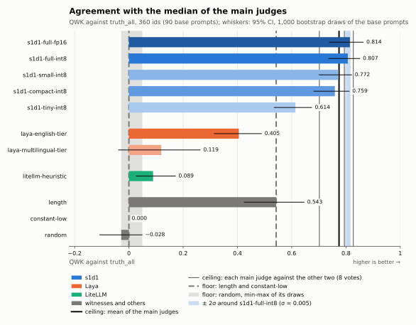
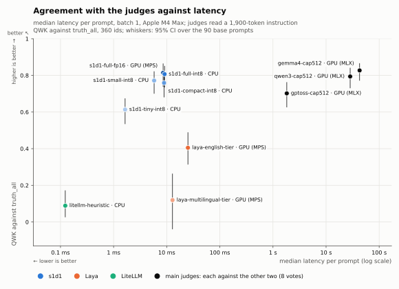
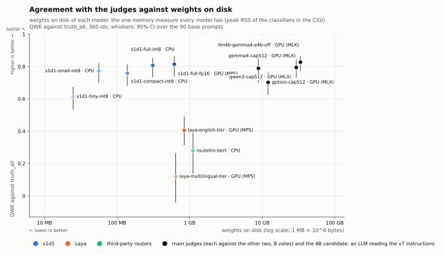
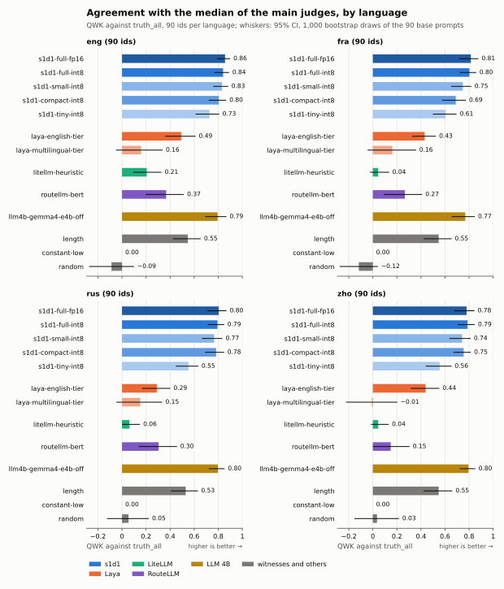
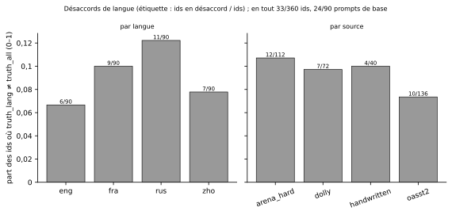
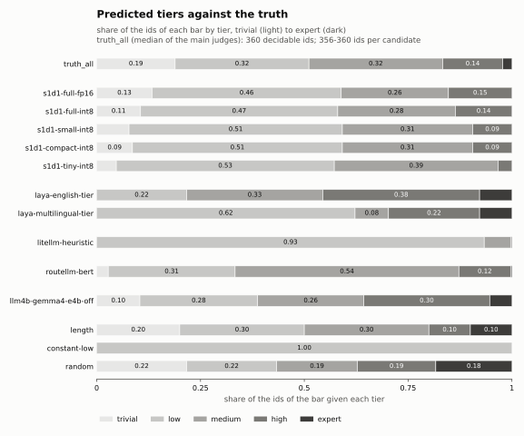
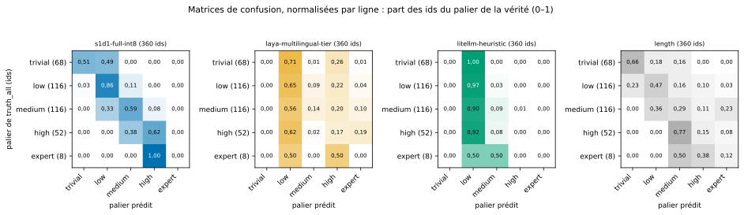
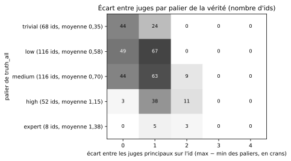
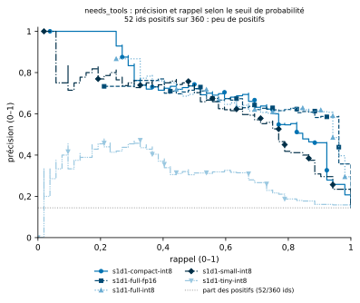
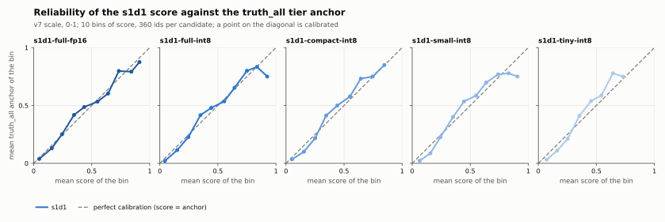

# Rapport du banc : base-v1

Écrit par `bench report` depuis les résultats de `bench run` du 2026-10-31. Entrées : prompts `data/prompts/base-v1.jsonl` (sha256 `e6a6d4c12ef8b95caea942337a3a1e16ec1622cb4e75c8ee0b473ef609a32490`), méta `data/prompts/base-v1.meta.parquet`, 5 juges, 14 classifieurs ; 360 ids, 90 prompts de base. Ce fichier se
régénère : les tableaux sont dans `tables/` (CSV), les figures dans `figures/` (SVG, chacune avec son CSV). Le gabarit
est `report/TEMPLATE.md` ; ses trous sont remplis par le code, chiffres tels qu'ils sortent.

## What this report says first

Two readings were written before seeing the figures (docs/34 § 7.4); the one that does not hold is stated first.

**Prediction 2 does not hold: `litellm-heuristic` (0.089 [0.026, 0.172]) is below `length` (0.543 [0.424, 0.647]), instead of sitting between `length` and `s1d1-full-int8` (0.807 [0.734, 0.852]).** Written before the figures (docs/34 § 7.4), it said: `litellm-heuristic` should sit between `length` and `s1d1-full-int8`. QWK against `truth_all`, 360 ids, 95% CI over 1,000 draws of the 90 base prompts. The check is made on the point values; the CIs of `litellm-heuristic` and `length` do not overlap; the CIs of `litellm-heuristic` and `s1d1-full-int8` do not overlap.

Prediction 1 holds: QWK of `litellm-heuristic` by language: eng 0.205 [0.094, 0.328]; fra 0.044 [−0.023, 0.135]; rus 0.061 [0.000, 0.149]; zho 0.044 [−0.016, 0.132]. The check is made on the point values only: the CIs of fra, rus and zho overlap that of eng (no paired gap between languages is computed). Written before the figures (docs/34 § 7.4), it said: the keyword lists of `litellm-heuristic` are English, its QWK should drop in French, in Russian and in Chinese. QWK against `truth_all`, 90 ids per language, 95% CI over 1,000 draws of the 90 base prompts.

Tables: [`tables/predictions.csv`](tables/predictions.csv), [`tables/by_language.csv`](tables/by_language.csv);
in this page: [Les deux prédictions, en tableau](#les-deux-prédictions-en-tableau).

_Note: the rest of this report is in French._

## La phrase de docs/32 § 5

> Sur 360 ids, soit 90 prompts de base en 4 langues, `s1d1-full-int8` s'accorde avec la médiane de
> 3 juges à QWK 0,807 [0,734 ; 0,852] ; le plafond inter-juges est 0,774 [0,718 ; 0,815] (chaque juge
> principal contre les deux autres, 8 votes et non 12 : `base-v1-gemma4-cap512` 0,827, `base-v1-qwen3-cap512` 0,794, `base-v1-gptoss-cap512` 0,702) ; Laya english 0,405 [0,314 ; 0,490], Laya
> multilingual 0,119 [−0,040 ; 0,264] ; l'heuristique de LiteLLM 0,089 [0,026 ; 0,172] ; la longueur du prompt 0,543 [0,424 ; 0,647].
> L'IC de `s1d1-full-int8` contient la moyenne du plafond ; `s1d1-full-int8` se distingue du plancher `length` selon la règle des 2 σ (écart apparié `s1d1-full-int8` − `length` : 0,264 [0,159 ; 0,383]).

Tableaux : [`tables/agreement_all.csv`](tables/agreement_all.csv), [`tables/ceiling.csv`](tables/ceiling.csv),
[`tables/paired.csv`](tables/paired.csv) ; dans cette page : [Les candidats contre
`truth_all`](#les-candidats-contre-truth_all), [Le plafond](#le-plafond--chaque-juge-principal-contre-les-deux-autres),
[Les écarts appariés](#les-écarts-appariés).

L'autre chiffre principal (même vérité, même unité) : `s1d1-full-fp16` 0,814 [0,738 ; 0,865].

Tous ces chiffres sont des QWK contre `truth_all`, la médiane des votes des 3 juges principaux sur les quatre
versions de chaque prompt de base, avec leur IC à 95 % : 1 000 tirages des 90 prompts de base, les quatre versions
suivent leur prompt de base. Clef-flash, nommé dans la phrase de [docs/32](../../docs/32-open-bench-kit.md), n'est pas
mesuré dans ce lot ([docs/34](../../docs/34-bench-run-report-lot3.md), décision 4 : non vérifié, docs/32 § 8).

Les deux clauses de la fin sont choisies par des règles écrites dans le code (`src/s1d1_bench/report_index.py`) :

- position par rapport au plafond : « contient la moyenne du plafond » quand la moyenne du plafond tombe dans l'IC du
  chiffre principal ; « est au-dessous de la moyenne du plafond » quand la borne haute de cet IC est au-dessous de la
  moyenne ; « est au-dessus de la moyenne du plafond » quand sa borne basse est au-dessus (un candidat au-dessus du
  plafond imite un juge, il ne dépasse pas la grille) ;
- plancher : « se distingue du plancher `length` » quand l'écart apparié du chiffre principal moins `length` passe la
  règle des 2 σ, « ne se distingue pas du plancher `length` » sinon.

**La règle des 2 σ** : aucune phrase de supériorité sans que l'IC de l'écart apparié exclue zéro et dépasse 2 σ, σ =
0,005 (le bruit des graines de s1d1, [docs/18](../../docs/README.md)) ; lecture stricte :
borne basse > 2 σ = 0,010 (ou, pour un écart négatif, borne haute < −0,010). Le tableau des écarts
appariés l'applique à chaque candidat ; hors de ce tableau, seules les deux prédictions, écrites avant les chiffres,
sont lues sur les valeurs ponctuelles, et le disent.

## Mises en garde (docs/32 § 2)

**Ce qui est mesuré.** Pour chaque classifieur, l'accord de ses sorties avec la médiane des juges : palier de
complexité (QWK, exactitude, exactitude à ± 1 palier, alpha ordinal, matrice de confusion), score (MAE contre l'ancre
du palier médian, diagramme de fiabilité, erreur de calibration attendue, pour les seuls scores sur l'échelle v7 ;
corrélation de rang et AUROC pour les autres scores), tâche (exactitude, F1 macro), `needs_tools` (F1, MCC, AUROC,
courbe précision-rappel, sur peu de positifs : l'IC le dit). Le palier de complexité est mesuré globalement, par langue,
par source, par origine et par palier de la vérité ; la tâche, `needs_tools` et le score le sont globalement seulement.

**Plafond et plancher.** Plafond = accord de chaque juge principal avec la médiane des autres ; un classifieur au-dessus
imite un juge, il ne dépasse pas la grille. Plancher = les témoins : aléatoire (dix tirages), longueur du prompt (en
caractères, seuils par quantiles) et `constant-low`. Entre les deux, le bruit des graines de s1d1
([docs/18](../../docs/README.md)) en bande : σ ≈ 0,005 QWK, repris comme nombre, pas remesuré.

**Ce qui n'est pas mesuré.**

- (a) Si la grille elle-même correspond à « quel modèle suffit » : c'est l'autre banc, celui des réponses, laissé de
  côté par décision de l'utilisateur (2026-10-28).
- (b) Le routage (le passage du score au modèle) : affaire du déployeur.
- (c) La distribution réelle des prompts : le jeu est construit par cases, et `expert` devait être la case la moins
  fournie. Ids par palier de `truth_all` : trivial 68, low 116, medium 116, high 52, expert 8 ids ([`tables/by_tier.csv`](tables/by_tier.csv)).
- (d) Les prompts agentiques et multi-tours : le jeu est fait de premiers prompts.
- (e) Les langues autres que les quatre choisies : [docs/17](../../docs/README.md) reste la seule mesure sur 78 langues.

## Comment lire

- **Les juges sont l'instrument de mesure, pas des concurrents.** Aucun tableau ne range un candidat face à un juge,
  sauf le plafond ; les juges ont leurs propres tableaux, sous ceux des candidats.
- **Les juges principaux sont dans la vérité** : `base-v1-gemma4-cap512`, `base-v1-qwen3-cap512`, `base-v1-gptoss-cap512`. `truth_all` est faite de leurs votes ; leur accord avec
  elle compte donc leurs propres votes (4 sur 12 par prompt de base), et la colonne « rôle » dit « juge dans la
  vérité ». Les autres juges (`base-v1-gemma4-off`, `base-v1-qwen3-off`) sont hors de la vérité : leur accord avec `truth_all` se lit avec les
  paires « même modèle » du tableau des juges, qui mesurent l'effet de la réflexion. Pour `truth_all_nogemma`, `base-v1-gemma4-cap512`
  sort de la vérité : avec deux juges (8 votes par prompt de base), la médiane est la moyenne des deux votes du milieu,
  arrondie vers le bas.
- **Unités** : « ids » compte les versions (une par langue, 360 en tout) ; « prompts de base » compte les
  `base_key` (90). Les IC tirent les prompts de base, jamais les ids.
- **Paliers jamais prédits** : `constant-low` : trivial, medium, high, expert ; `laya-english-tier` : trivial ; `laya-multilingual-tier` : trivial ; `litellm-heuristic` : trivial, expert ; `nvidia-ptcc-eng` : high, expert ; `s1d1-compact-int8` : expert ; `s1d1-full-fp16` : expert ; `s1d1-full-int8` : expert ; `s1d1-small-int8` : expert ; `s1d1-tiny-int8` : expert ([`tables/agreement_all.csv`](tables/agreement_all.csv),
  colonne « paliers jamais prédits »). Le QWK reste sur l'échelle à cinq paliers : un candidat qui
  ne prédit jamais un palier est au mieux à un cran sur les ids de ce palier.
- **Indécidables, abstentions, votes nuls** : indécidables : 0 id (sortis de toute mesure de palier) ;
  abstentions : 1 id : `base-v1-gptoss-cap512` sur `3ce175ed3ef6b933-zho` : refus (json_error) ; votes nuls de complexité : `base-v1-gemma4-cap512` 1 id : `e944f9b1b3bbc893-fra` ; `base-v1-gptoss-cap512` 1 id : `3ce175ed3ef6b933-zho` (abstention) ([`tables/inputs.csv`](tables/inputs.csv), le
  tableau des dossiers ci-dessous). Un vote nul retire l'id pour ce juge seulement.
- Un nombre suivi de crochets est une valeur ponctuelle et son IC à 95 % ; « — » : non défini (par exemple un QWK sur
  un sous-groupe qui n'a qu'un palier de vérité).

## Les dossiers

| nom | type | rôle | modèle | révision | date | ids en abstention | ids à vote nul | ids des votes nuls |
|---|---|---|---|---|---|---|---|---|
| base-v1-gemma4-cap512 | juge | juge dans la vérité | mlx-community/gemma-4-31b-it-8bit | f5f3dc92ab4af76724c36c21eb6bedadb3a851be | 2026-10-30 | 0 | 1 | e944f9b1b3bbc893-fra |
| base-v1-qwen3-cap512 | juge | juge dans la vérité | mlx-community/Qwen3.8-27B-8bit | 815b83c0df8ffd1d1b5244cf75fd6ef14fca9ef9 | 2026-10-30 | 0 | 0 |  |
| base-v1-gptoss-cap512 | juge | juge dans la vérité | mlx-community/gpt-oss-20b-MXFP4-Q8 | 773a7da77e569019bb0fd17a554b263738d669a3 | 2026-10-30 | 1 | 1 | 3ce175ed3ef6b933-zho |
| base-v1-gemma4-off | juge | juge hors de la vérité | mlx-community/gemma-4-31b-it-8bit | f5f3dc92ab4af76724c36c21eb6bedadb3a851be | 2026-10-30 | 0 | 0 |  |
| base-v1-qwen3-off | juge | juge hors de la vérité | mlx-community/Qwen3.8-27B-8bit | 815b83c0df8ffd1d1b5244cf75fd6ef14fca9ef9 | 2026-10-30 | 0 | 0 |  |
| constant-low | classifieur | candidat | witness:constant-low | — | 2026-10-30 | — | — | — |
| laya-english-tier | classifieur | candidat | convaiinnovations/laya | laya 0.4.15 convaiinnovations/laya@7b928d828b7b0e022f929d9bd2e44165aa270148 | 2026-10-30 | — | — | — |
| laya-multilingual-tier | classifieur | candidat | convaiinnovations/laya/multilingual | laya 0.4.15 convaiinnovations/laya@7b928d828b7b0e022f929d9bd2e44165aa270148 | 2026-10-30 | — | — | — |
| length | classifieur | candidat | witness:length | — | 2026-10-30 | — | — | — |
| litellm-heuristic | classifieur | candidat | litellm:complexity_router:heuristic | v1.106.6 61c6ab78393ef45683dd7d963d2a315bd845e20b | 2026-10-30 | — | — | — |
| llm4b-gemma4-e4b-off | classifieur | candidat | mlx-community/gemma-4-e4b-it-8bit | 4255b21bd9a9d3fc807ef7abd80373f5e3a52a73 | 2026-10-31 | — | — | — |
| nvidia-ptcc-eng | classifieur | candidat | nvidia/prompt-task-and-complexity-classifier | fea1121511eafabaf7dd6fc66863dcb04f74defb | 2026-10-31 | — | — | — |
| random | classifieur | candidat | witness:random | seed 0 | 2026-10-30 | — | — | — |
| routellm-bert | classifieur | candidat | routellm/bert_gpt4_augmented | 86237e3df400762178ea98379477b8296e66d5e4 | 2026-10-31 | — | — | — |
| s1d1-compact-int8 | classifieur | candidat | scombat/s1d1-router-6src-compact-onnx-int8 | 7e87870132a19d12b32dbad1f8233801b8145b9f | 2026-10-30 | — | — | — |
| s1d1-full-fp16 | classifieur | candidat | scombat/s1d1-router | 7fb9a4e3d03e3d942a98648268ff76c6152c18d6 | 2026-10-30 | — | — | — |
| s1d1-full-int8 | classifieur | candidat | scombat/s1d1-router-6src-full-onnx-int8 | 068d0d20d5901c2db6934c89fde48b87c973fed8 | 2026-10-30 | — | — | — |
| s1d1-small-int8 | classifieur | candidat | scombat/s1d1-router-6src-small-onnx-int8 | 33c7f34a30af04735390264824d6bfa8546abb7a | 2026-10-30 | — | — | — |
| s1d1-tiny-int8 | classifieur | candidat | scombat/s1d1-router-6src-tiny-onnx-int8 | dac13b5c0356864ea4501fa151d74dcd8b3ea22a | 2026-10-30 | — | — | — |

Les dossiers Laya de ce rapport sont `laya-english-tier`, `laya-multilingual-tier`, et seulement eux. Laya répond à la question à quatre paliers de
LiteLLM et se lit nom à nom (SIMPLE → low, MEDIUM → medium, COMPLEX → high, REASONING → expert, jamais trivial), comme
l'heuristique de LiteLLM : deux candidats qui répondent à la même question se lisent avec la même table (docs/34 § 8).
Les dossiers `laya-english` et `laya-multilingual` de la PR A tiraient le palier de l'ancre la plus proche
(`nearest_anchor(attendu / 3)` : SIMPLE → trivial, MEDIUM → low, COMPLEX → high) ; ils ne sont pas dans ce rapport pour
cette raison, restent dans `classifiers/` sans modification, et `bench run` ne les charge pas. Dossiers de la racine
des classifieurs que ce run n'a pas chargés : `laya-english`, `laya-multilingual`.

| élément | valeur |
|---|---|
| prompts | data/prompts/base-v1.jsonl |
| sha256 des prompts | e6a6d4c12ef8b95caea942337a3a1e16ec1622cb4e75c8ee0b473ef609a32490 |
| méta | data/prompts/base-v1.meta.parquet |
| date du run | 2026-10-31 |
| lignes | 360 ids |
| prompts de base | 90 prompts de base |
| langues | eng, fra, rus, zho |
| juges principaux | base-v1-gemma4-cap512, base-v1-qwen3-cap512, base-v1-gptoss-cap512 |
| juge Gemma (sorti de truth_all_nogemma) | base-v1-gemma4-cap512 |
| indécidables | 0 id |
| abstentions | 1 id |
| bootstrap | 1 000 tirages des 90 prompts de base, graine 0, IC 95 % |
| tirages de random | 10 tirages |
| σ | 0,005 |

## Accord avec la vérité

### Les candidats contre `truth_all`

_QWK contre truth_all (360 ids), IC 95 % sur 1 000 tirages des 90 prompts de base ; plafond, plancher, ± 2 σ._ Données : [`figures/qwk-bars.csv`](figures/qwk-bars.csv).

Barres : QWK de chaque candidat contre `truth_all` et son IC à 95 % ; ligne noire : le plafond, moyenne des juges
principaux ; lignes gris foncé : chaque juge principal contre les deux autres ; lignes grises en tirets et bande grise :
le plancher (`length`, `constant-low`, les tirages de `random`) ; bande bleue : ± 2 σ autour de `s1d1-full-int8`,
étroite par nature (σ = 0,005). Le chiffre principal est à hauteur du plafond inter-juges quand son IC contient la
moyenne du plafond ; ici, l'IC de `s1d1-full-int8` contient la moyenne du plafond.
Les témoins font le plancher ; sous la longueur du prompt, en valeurs ponctuelles :
`laya-english-tier`, `laya-multilingual-tier`, `litellm-heuristic`, `nvidia-ptcc-eng` et `routellm-bert`.
Une position sur la figure n'est pas une phrase de supériorité : seule la règle des 2 σ en permet une (l'IC de l'écart
apparié exclut zéro et dépasse 2 σ = 0,010), voir [Les écarts appariés](#les-écarts-appariés).

| nom | ids | QWK | exact | ± 1 | alpha ordinal | paliers jamais prédits |
|---|---|---|---|---|---|---|
| constant-low | 360 | 0,000 [0,000 ; 0,000] | 0,322 [0,222 ; 0,422] | 0,833 [0,756 ; 0,900] | −0,094 [−0,217 ; −0,021] | trivial, medium, high, expert |
| laya-english-tier | 360 | 0,405 [0,314 ; 0,490] | 0,311 [0,247 ; 0,386] | 0,783 [0,722 ; 0,842] | 0,332 [0,185 ; 0,454] | trivial |
| laya-multilingual-tier | 360 | 0,119 [−0,040 ; 0,264] | 0,278 [0,203 ; 0,353] | 0,728 [0,653 ; 0,800] | 0,102 [−0,067 ; 0,250] | trivial |
| length | 360 | 0,543 [0,424 ; 0,647] | 0,394 [0,300 ; 0,483] | 0,839 [0,761 ; 0,906] | 0,602 [0,463 ; 0,708] |  |
| litellm-heuristic | 360 | 0,089 [0,026 ; 0,172] | 0,342 [0,250 ; 0,436] | 0,844 [0,772 ; 0,908] | 0,042 [−0,091 ; 0,147] | trivial, expert |
| llm4b-gemma4-e4b-off | 356 | 0,789 [0,698 ; 0,853] | 0,545 [0,447 ; 0,643] | 0,989 [0,966 ; 1,000] | 0,782 [0,683 ; 0,851] |  |
| nvidia-ptcc-eng | 90 | 0,311 [0,209 ; 0,415] | 0,267 [0,178 ; 0,356] | 0,800 [0,711 ; 0,878] | 0,207 [0,021 ; 0,375] | high, expert |
| random | 360 | −0,028 [−0,109 ; 0,050] | 0,183 [0,142 ; 0,228] | 0,528 [0,469 ; 0,583] | −0,056 [−0,153 ; 0,032] |  |
| routellm-bert | 360 | 0,278 [0,132 ; 0,408] | 0,381 [0,303 ; 0,467] | 0,819 [0,744 ; 0,889] | 0,264 [0,078 ; 0,419] |  |
| s1d1-compact-int8 | 360 | 0,759 [0,680 ; 0,813] | 0,633 [0,550 ; 0,714] | 0,989 [0,972 ; 1,000] | 0,769 [0,683 ; 0,826] | expert |
| s1d1-full-fp16 | 360 | 0,814 [0,738 ; 0,865] | 0,678 [0,592 ; 0,756] | 0,992 [0,978 ; 1,000] | 0,813 [0,729 ; 0,869] | expert |
| s1d1-full-int8 | 360 | 0,807 [0,734 ; 0,852] | 0,656 [0,569 ; 0,733] | 1,000 [1,000 ; 1,000] | 0,808 [0,725 ; 0,859] | expert |
| s1d1-small-int8 | 360 | 0,772 [0,700 ; 0,822] | 0,650 [0,561 ; 0,731] | 0,992 [0,981 ; 1,000] | 0,786 [0,708 ; 0,834] | expert |
| s1d1-tiny-int8 | 360 | 0,614 [0,534 ; 0,675] | 0,528 [0,442 ; 0,608] | 0,969 [0,939 ; 0,994] | 0,655 [0,565 ; 0,721] | expert |

### Le plafond : chaque juge principal contre les deux autres

| juge | ids | QWK | exact | note |
|---|---|---|---|---|
| base-v1-gemma4-cap512 | 359 | 0,827 [0,771 ; 0,866] | 0,660 [0,570 ; 0,738] | plafond sur 8 votes, pas 12 |
| base-v1-qwen3-cap512 | 360 | 0,794 [0,730 ; 0,841] | 0,578 [0,486 ; 0,661] | plafond sur 8 votes, pas 12 |
| base-v1-gptoss-cap512 | 359 | 0,702 [0,626 ; 0,763] | 0,563 [0,482 ; 0,644] | plafond sur 8 votes, pas 12 |
| moyenne | — | 0,774 [0,718 ; 0,815] | 0,600 [0,523 ; 0,671] | plafond sur 8 votes, pas 12 |

Chaque juge principal est noté contre la médiane des deux autres : 8 votes par prompt de base, pas 12. Leur moyenne est
le plafond de la phrase.

### Le plancher

| nom | type | tirage | ids | QWK | exact | ± 1 |
|---|---|---|---|---|---|---|
| length | témoin informé | — | 360 | 0,543 [0,424 ; 0,647] | 0,394 [0,300 ; 0,483] | 0,839 [0,761 ; 0,906] |
| constant-low | témoin constant | — | 360 | 0,000 [0,000 ; 0,000] | 0,322 [0,222 ; 0,422] | 0,833 [0,756 ; 0,900] |
| random | tirage | 0 | 360 | −0,028 | 0,183 | 0,528 |
| random | tirage | 1 | 360 | 0,046 | 0,211 | 0,603 |
| random | tirage | 2 | 360 | 0,009 | 0,214 | 0,558 |
| random | tirage | 3 | 360 | 0,049 | 0,200 | 0,564 |
| random | tirage | 4 | 360 | −0,019 | 0,139 | 0,567 |
| random | tirage | 5 | 360 | 0,048 | 0,200 | 0,561 |
| random | tirage | 6 | 360 | 0,013 | 0,233 | 0,586 |
| random | tirage | 7 | 360 | −0,009 | 0,231 | 0,564 |
| random | tirage | 8 | 360 | −0,001 | 0,225 | 0,569 |
| random | tirage | 9 | 360 | 0,031 | 0,208 | 0,597 |
| random | minimum des tirages | — | — | −0,028 | 0,139 | 0,528 |
| random | maximum des tirages | — | — | 0,049 | 0,233 | 0,603 |
| random | moyenne des tirages | — | — | 0,014 | 0,204 | 0,570 |

`length` est le témoin informé ; `constant-low` dit `low` partout ; `random` : ses dix tirages, leur minimum, maximum et
moyenne, sans IC (la bande, ce sont eux).

93,3 % des paliers de `litellm-heuristic` sont `low` (360 ids) : son exactitude se lit à côté de celle de `constant-low`, qui dit `low` partout.

| nom | ids | exact | part de low (ids) |
|---|---|---|---|
| litellm-heuristic | 360 | 0,342 [0,250 ; 0,436] | 0,933 |
| constant-low | 360 | 0,322 [0,222 ; 0,422] | 1,000 |

### Les écarts appariés

| candidat | écart apparié de QWK (s1d1-full-int8 − candidat) | règle des 2 σ | pourquoi |
|---|---|---|---|
| constant-low | 0,807 [0,734 ; 0,852] | passe | l'IC exclut zéro et se tient au-delà de 2 σ |
| laya-english-tier | 0,402 [0,309 ; 0,498] | passe | l'IC exclut zéro et se tient au-delà de 2 σ |
| laya-multilingual-tier | 0,687 [0,530 ; 0,836] | passe | l'IC exclut zéro et se tient au-delà de 2 σ |
| length | 0,264 [0,159 ; 0,383] | passe | l'IC exclut zéro et se tient au-delà de 2 σ |
| litellm-heuristic | 0,718 [0,614 ; 0,799] | passe | l'IC exclut zéro et se tient au-delà de 2 σ |
| llm4b-gemma4-e4b-off | 0,018 [−0,067 ; 0,105] | ne passe pas | l'IC contient zéro |
| nvidia-ptcc-eng | 0,496 [0,371 ; 0,603] | passe | l'IC exclut zéro et se tient au-delà de 2 σ |
| random | 0,835 [0,734 ; 0,924] | passe | l'IC exclut zéro et se tient au-delà de 2 σ |
| routellm-bert | 0,528 [0,388 ; 0,668] | passe | l'IC exclut zéro et se tient au-delà de 2 σ |
| s1d1-compact-int8 | 0,048 [0,009 ; 0,089] | ne passe pas | l'IC exclut zéro, mais sa borne la plus proche de zéro n'est pas au-delà de 2 σ |
| s1d1-full-fp16 | −0,008 [−0,031 ; 0,020] | ne passe pas | l'IC contient zéro |
| s1d1-small-int8 | 0,035 [−0,004 ; 0,076] | ne passe pas | l'IC contient zéro |
| s1d1-tiny-int8 | 0,193 [0,126 ; 0,267] | passe | l'IC exclut zéro et se tient au-delà de 2 σ |

Écart du QWK de `s1d1-full-int8` moins celui de chaque autre candidat, sur les mêmes tirages des prompts de base ; « passe »
selon la règle des 2 σ (borne basse > 0,010, ou borne haute < −0,010), « ne passe pas » sinon.

### Les juges contre `truth_all` (l'instrument)

| nom | rôle | ids | QWK | exact | ± 1 | alpha ordinal | paliers jamais prédits |
|---|---|---|---|---|---|---|---|
| base-v1-gemma4-cap512 | juge dans la vérité | 359 | 0,941 [0,910 ; 0,962] | 0,877 [0,825 ; 0,922] | 1,000 [1,000 ; 1,000] | 0,946 [0,915 ; 0,966] |  |
| base-v1-qwen3-cap512 | juge dans la vérité | 360 | 0,899 [0,855 ; 0,931] | 0,750 [0,672 ; 0,825] | 1,000 [1,000 ; 1,000] | 0,905 [0,858 ; 0,935] |  |
| base-v1-gptoss-cap512 | juge dans la vérité | 359 | 0,746 [0,672 ; 0,803] | 0,638 [0,560 ; 0,717] | 0,967 [0,939 ; 0,989] | 0,762 [0,669 ; 0,829] | expert |
| base-v1-gemma4-off | juge hors de la vérité | 360 | 0,915 [0,874 ; 0,945] | 0,817 [0,742 ; 0,881] | 0,997 [0,992 ; 1,000] | 0,920 [0,872 ; 0,951] |  |
| base-v1-qwen3-off | juge hors de la vérité | 360 | 0,872 [0,821 ; 0,908] | 0,672 [0,578 ; 0,758] | 1,000 [1,000 ; 1,000] | 0,878 [0,816 ; 0,916] |  |

Les juges principaux sont dans la vérité : leur accord avec elle est gonflé par leurs propres votes ; le chiffre qui
les compare à la médiane des autres est le plafond. Les juges hors de la vérité ne sont pas dans `truth_all` : leur accord
avec elle se lit avec les paires « même modèle » du tableau des juges, qui mesurent l'effet de la réflexion.

### Sans Gemma 4 : `truth_all_nogemma`

| nom | ids | QWK | exact | ± 1 | alpha ordinal | paliers jamais prédits |
|---|---|---|---|---|---|---|
| constant-low | 360 | 0,000 [0,000 ; 0,000] | 0,256 [0,167 ; 0,344] | 0,922 [0,867 ; 0,967] | −0,054 [−0,159 ; −0,003] | trivial, medium, high, expert |
| laya-english-tier | 360 | 0,347 [0,267 ; 0,417] | 0,222 [0,164 ; 0,286] | 0,747 [0,683 ; 0,808] | 0,227 [0,077 ; 0,339] | trivial |
| laya-multilingual-tier | 360 | 0,115 [−0,020 ; 0,249] | 0,244 [0,169 ; 0,319] | 0,781 [0,717 ; 0,844] | 0,090 [−0,069 ; 0,246] | trivial |
| length | 360 | 0,478 [0,344 ; 0,592] | 0,422 [0,325 ; 0,520] | 0,825 [0,750 ; 0,894] | 0,533 [0,373 ; 0,656] |  |
| litellm-heuristic | 360 | 0,106 [0,038 ; 0,190] | 0,281 [0,194 ; 0,375] | 0,939 [0,889 ; 0,978] | 0,080 [−0,033 ; 0,173] | trivial, expert |
| llm4b-gemma4-e4b-off | 356 | 0,713 [0,628 ; 0,774] | 0,396 [0,308 ; 0,492] | 0,975 [0,941 ; 1,000] | 0,709 [0,594 ; 0,780] |  |
| nvidia-ptcc-eng | 90 | 0,394 [0,286 ; 0,498] | 0,311 [0,222 ; 0,411] | 0,867 [0,789 ; 0,933] | 0,323 [0,135 ; 0,468] | high, expert |
| random | 360 | 0,003 [−0,076 ; 0,088] | 0,200 [0,156 ; 0,242] | 0,558 [0,503 ; 0,619] | −0,043 [−0,149 ; 0,063] |  |
| routellm-bert | 360 | 0,223 [0,092 ; 0,347] | 0,386 [0,308 ; 0,467] | 0,811 [0,736 ; 0,878] | 0,209 [0,035 ; 0,365] |  |
| s1d1-compact-int8 | 360 | 0,722 [0,634 ; 0,786] | 0,600 [0,517 ; 0,681] | 0,994 [0,983 ; 1,000] | 0,733 [0,638 ; 0,797] | expert |
| s1d1-full-fp16 | 360 | 0,794 [0,716 ; 0,845] | 0,656 [0,569 ; 0,736] | 0,997 [0,992 ; 1,000] | 0,803 [0,728 ; 0,854] | expert |
| s1d1-full-int8 | 360 | 0,785 [0,713 ; 0,834] | 0,650 [0,569 ; 0,728] | 1,000 [1,000 ; 1,000] | 0,799 [0,728 ; 0,846] | expert |
| s1d1-small-int8 | 360 | 0,736 [0,664 ; 0,789] | 0,608 [0,528 ; 0,683] | 1,000 [1,000 ; 1,000] | 0,757 [0,684 ; 0,806] | expert |
| s1d1-tiny-int8 | 360 | 0,612 [0,539 ; 0,670] | 0,531 [0,453 ; 0,606] | 0,989 [0,978 ; 0,997] | 0,642 [0,548 ; 0,705] | expert |

Les mêmes candidats contre la médiane des juges principaux sans `base-v1-gemma4-cap512` (les deux chiffres de la décision 9 de
[docs/32](../../docs/32-open-bench-kit.md), que cite la décision 3 de
[docs/34](../../docs/34-bench-run-report-lot3.md)).

| nom | rôle | ids | QWK | exact | ± 1 | alpha ordinal | paliers jamais prédits |
|---|---|---|---|---|---|---|---|
| base-v1-gemma4-cap512 | juge hors de la vérité | 359 | 0,827 [0,771 ; 0,866] | 0,660 [0,570 ; 0,738] | 1,000 [1,000 ; 1,000] | 0,850 [0,792 ; 0,888] |  |
| base-v1-qwen3-cap512 | juge dans la vérité | 360 | 0,854 [0,805 ; 0,886] | 0,650 [0,564 ; 0,731] | 1,000 [1,000 ; 1,000] | 0,868 [0,795 ; 0,908] |  |
| base-v1-gptoss-cap512 | juge dans la vérité | 359 | 0,813 [0,745 ; 0,865] | 0,752 [0,694 ; 0,808] | 0,983 [0,961 ; 0,997] | 0,814 [0,741 ; 0,868] | expert |
| base-v1-gemma4-off | juge hors de la vérité | 360 | 0,822 [0,766 ; 0,860] | 0,628 [0,528 ; 0,717] | 0,997 [0,992 ; 1,000] | 0,847 [0,785 ; 0,888] |  |
| base-v1-qwen3-off | juge hors de la vérité | 360 | 0,813 [0,760 ; 0,851] | 0,544 [0,450 ; 0,633] | 0,994 [0,983 ; 1,000] | 0,823 [0,737 ; 0,873] |  |

### Les paires de juges

| juge A | rôle A | juge B | rôle B | ids | ids écartés | QWK | exact | même modèle (réflexion) |
|---|---|---|---|---|---|---|---|---|
| base-v1-gemma4-cap512 | juge dans la vérité | base-v1-qwen3-cap512 | juge dans la vérité | 359 | 1 | 0,879 [0,831 ; 0,912] | 0,705 [0,631 ; 0,776] | non |
| base-v1-gemma4-cap512 | juge dans la vérité | base-v1-gptoss-cap512 | juge dans la vérité | 358 | 2 | 0,707 [0,634 ; 0,763] | 0,564 [0,489 ; 0,642] | non |
| base-v1-gemma4-cap512 | juge dans la vérité | base-v1-gemma4-off | juge hors de la vérité | 359 | 1 | 0,913 [0,876 ; 0,939] | 0,816 [0,755 ; 0,866] | oui |
| base-v1-gemma4-cap512 | juge dans la vérité | base-v1-qwen3-off | juge hors de la vérité | 359 | 1 | 0,865 [0,815 ; 0,900] | 0,660 [0,582 ; 0,733] | non |
| base-v1-qwen3-cap512 | juge dans la vérité | base-v1-gptoss-cap512 | juge dans la vérité | 359 | 1 | 0,686 [0,613 ; 0,740] | 0,471 [0,388 ; 0,543] | non |
| base-v1-qwen3-cap512 | juge dans la vérité | base-v1-gemma4-off | juge hors de la vérité | 360 | 0 | 0,891 [0,842 ; 0,924] | 0,722 [0,650 ; 0,789] | non |
| base-v1-qwen3-cap512 | juge dans la vérité | base-v1-qwen3-off | juge hors de la vérité | 360 | 0 | 0,923 [0,886 ; 0,947] | 0,778 [0,706 ; 0,839] | oui |
| base-v1-gptoss-cap512 | juge dans la vérité | base-v1-gemma4-off | juge hors de la vérité | 359 | 1 | 0,699 [0,634 ; 0,753] | 0,554 [0,475 ; 0,632] | non |
| base-v1-gptoss-cap512 | juge dans la vérité | base-v1-qwen3-off | juge hors de la vérité | 359 | 1 | 0,666 [0,587 ; 0,728] | 0,465 [0,376 ; 0,549] | non |
| base-v1-gemma4-off | juge hors de la vérité | base-v1-qwen3-off | juge hors de la vérité | 360 | 0 | 0,877 [0,822 ; 0,911] | 0,678 [0,594 ; 0,750] | non |

Chaque paire de juges sur les ids où les deux votent (le pendant de `bench agree`) ; « même modèle (réflexion) » marque
les deux réglages d'un même modèle, sans réflexion et réflexion plafonnée à 512 : l'effet de la réflexion.

## Vitesse et empreinte

_QWK contre truth_all (360 ids) contre la latence médiane par prompt (lot de 1, échelle logarithmique) ; juges principaux : QWK contre les deux autres._ Données : [`figures/quality-vs-latency.csv`](figures/quality-vs-latency.csv).

Latence médiane par prompt, lot de 1, sur le même Mac (classifieurs : après chauffe ; juges : leurs journaux, une
consigne et un prompt à la fois) : s1d1 int8 et LiteLLM sur le CPU, s1d1 fp16 et Laya sur le GPU (MPS), les juges sur
le GPU (MLX) ; la latence d'un juge comprend la lecture de la consigne v7 (environ 1 900 jetons), puis son raisonnement
(réflexion plafonnée à 512 jetons) et sa réponse. En ordonnée, le QWK contre `truth_all` ; pour un juge principal, son
QWK contre la médiane des deux autres (le plafond, 8 votes), le chiffre des lignes du plafond des barres. L'IC de
`s1d1-full-int8` contient la moyenne du plafond ;
`s1d1-full-int8` répond par prompt en 9,1 ms sur le CPU.
Les variantes int8 de s1d1, sur le CPU, répondent en 1,6 à 9,1 ms ; leur QWK se lit point par point.
Un juge principal met, sur le GPU du même Mac et en lisant la consigne, 1,8 à 42,8 s.
Au 95e centile, la latence des variantes int8 de s1d1 sur le CPU (« p95 » du tableau ci-dessous) :
12,8 à 78,7 ms ; la médiane est la valeur portée (le profil ne garde pas la latence de chaque prompt : la cause de
cette queue n'y est pas mesurée). Les témoins (`random`, `length`, `constant-low`) ne sont pas des modèles : ils n'ont
ni latence ni poids, et ne sont ni dans cette figure ni dans la suivante.

_QWK contre truth_all (360 ids) contre le poids des fichiers de poids sur disque (échelle logarithmique) ; juges principaux : QWK contre les deux autres._ Données : [`figures/quality-vs-footprint.csv`](figures/quality-vs-footprint.csv). Absent de la figure : `litellm-heuristic` : pas de fichier de poids (0 Mo), hors de l'axe logarithmique : pas de point.

Poids des fichiers de poids sur disque (Mo de 10⁶ octets), la seule mesure de mémoire que tous les modèles ont.
Les poids de `s1d1-full-int8` font 310 Mo ;
ceux des variantes de s1d1 tiennent dans 25 à 615 Mo, leur QWK se lisant point par point ;
ceux de Laya font, selon la tête, 644 à 843 Mo ;
les juges principaux demandent 12,1 à 33,8 Go.
Ordonnée et juges comme dans la figure de la latence. Un modèle sans fichier de poids (des règles, 0 Mo) ne se place
pas sur un axe logarithmique : il est nommé sous la figure.

| nom | type | rôle | appareil | latence médiane (ms) | p95 (ms) | moyenne (ms) | poids sur disque (Mo) | RSS de crête (Mo) |
|---|---|---|---|---|---|---|---|---|
| laya-english-tier | classifieur | candidat | mps | 25,1 | 50,8 | 30,0 | 842,6 | 2932,1 |
| laya-multilingual-tier | classifieur | candidat | mps | 12,8 | 30,2 | 15,5 | 643,8 | 2708,9 |
| litellm-heuristic | classifieur | candidat | cpu | 0,1 | 1,2 | 0,3 | 0,0 | 24,5 |
| llm4b-gemma4-e4b-off | classifieur | candidat | gpu-mlx | 1098,5 | 1308,5 | 1127,0 | 8881,0 | — |
| nvidia-ptcc-eng | classifieur | candidat | cpu | 107,9 | 112,9 | 108,8 | 735,5 | 1807,0 |
| routellm-bert | classifieur | candidat | cpu | 16,3 | 52,9 | 21,0 | 1112,2 | 1357,8 |
| s1d1-compact-int8 | classifieur | candidat | cpu | 8,9 | 78,7 | 20,0 | 138,5 | 914,4 |
| s1d1-full-fp16 | classifieur | candidat | mps | 8,6 | 21,9 | 10,6 | 615,1 | 937,4 |
| s1d1-full-int8 | classifieur | candidat | cpu | 9,1 | 76,8 | 20,1 | 310,3 | 1284,6 |
| s1d1-small-int8 | classifieur | candidat | cpu | 5,8 | 44,7 | 12,0 | 56,0 | 680,4 |
| s1d1-tiny-int8 | classifieur | candidat | cpu | 1,6 | 12,8 | 3,5 | 24,7 | 638,4 |
| base-v1-gemma4-cap512 | juge | juge dans la vérité | gpu-mlx | 42786,5 | 67715,4 | 44751,1 | 33763,1 | — |
| base-v1-qwen3-cap512 | juge | juge dans la vérité | gpu-mlx | 28433,5 | 53776,9 | 30389,2 | 29501,2 | — |
| base-v1-gptoss-cap512 | juge | juge dans la vérité | gpu-mlx | 1821,0 | 2634,6 | 1911,2 | 12076,2 | — |
| base-v1-gemma4-off | juge | juge hors de la vérité | gpu-mlx | 12635,5 | 15700,1 | 12989,2 | 33763,1 | — |
| base-v1-qwen3-off | juge | juge hors de la vérité | gpu-mlx | 9153,5 | 11039,8 | 9425,5 | 29501,2 | — |

Le profil de `bench profile` : latence par prompt à lot de 1 après chauffe (médiane, 95e centile, moyenne), poids des
fichiers de poids sur disque et mémoire de crête du processus. La mémoire de crête (RSS) n'est pas dans les figures :
elle comprend l'interpréteur et les bibliothèques, sur MPS la mémoire du pilote du GPU peut y manquer, et elle ne se
mesure pas après coup pour les juges (« — »). Les témoins n'y sont pas.

## Par langue

_QWK contre truth_all par langue (ids de la langue), IC 95 % sur 1 000 tirages des 90 prompts de base._ Données : [`figures/qwk-by-language.csv`](figures/qwk-by-language.csv).

QWK de chaque candidat contre `truth_all` dans chaque langue, un même ordre des candidats dans tous les panneaux.
`s1d1-full-int8` par langue : eng 0,840, fra 0,802, rus 0,793, zho 0,787 ;
`litellm-heuristic` par langue : eng 0,205, fra 0,044, rus 0,061, zho 0,044
(ses listes de mots-clés sont anglaises ; la prédiction 1, en tête du rapport, lit ces valeurs ponctuelles).

| nom | langue | ids | QWK (truth_all) | exact (truth_all) | QWK (truth_lang) | exact (truth_lang) |
|---|---|---|---|---|---|---|
| constant-low | eng | 90 | 0,000 [0,000 ; 0,000] | 0,322 [0,222 ; 0,422] | 0,000 [0,000 ; 0,000] | 0,344 [0,244 ; 0,444] |
| constant-low | fra | 90 | 0,000 [0,000 ; 0,000] | 0,322 [0,222 ; 0,422] | 0,000 [0,000 ; 0,000] | 0,300 [0,211 ; 0,389] |
| constant-low | rus | 90 | 0,000 [0,000 ; 0,000] | 0,322 [0,222 ; 0,422] | 0,000 [0,000 ; 0,000] | 0,300 [0,211 ; 0,400] |
| constant-low | zho | 90 | 0,000 [0,000 ; 0,000] | 0,322 [0,222 ; 0,422] | 0,000 [0,000 ; 0,000] | 0,289 [0,200 ; 0,378] |
| laya-english-tier | eng | 90 | 0,491 [0,359 ; 0,611] | 0,367 [0,278 ; 0,467] | 0,487 [0,357 ; 0,607] | 0,356 [0,256 ; 0,456] |
| laya-english-tier | fra | 90 | 0,430 [0,326 ; 0,524] | 0,244 [0,167 ; 0,333] | 0,451 [0,341 ; 0,547] | 0,211 [0,133 ; 0,300] |
| laya-english-tier | rus | 90 | 0,289 [0,167 ; 0,401] | 0,267 [0,178 ; 0,356] | 0,299 [0,161 ; 0,437] | 0,322 [0,244 ; 0,422] |
| laya-english-tier | zho | 90 | 0,438 [0,315 ; 0,552] | 0,367 [0,267 ; 0,467] | 0,475 [0,359 ; 0,585] | 0,356 [0,256 ; 0,456] |
| laya-multilingual-tier | eng | 90 | 0,158 [−0,050 ; 0,337] | 0,289 [0,200 ; 0,378] | 0,153 [−0,073 ; 0,353] | 0,333 [0,233 ; 0,422] |
| laya-multilingual-tier | fra | 90 | 0,162 [−0,044 ; 0,359] | 0,278 [0,189 ; 0,378] | 0,153 [−0,045 ; 0,349] | 0,233 [0,156 ; 0,322] |
| laya-multilingual-tier | rus | 90 | 0,152 [−0,047 ; 0,334] | 0,267 [0,178 ; 0,356] | 0,172 [−0,030 ; 0,376] | 0,289 [0,200 ; 0,389] |
| laya-multilingual-tier | zho | 90 | −0,009 [−0,223 ; 0,203] | 0,278 [0,189 ; 0,367] | −0,020 [−0,224 ; 0,189] | 0,267 [0,189 ; 0,356] |
| length | eng | 90 | 0,547 [0,424 ; 0,654] | 0,422 [0,322 ; 0,511] | 0,533 [0,405 ; 0,646] | 0,411 [0,311 ; 0,511] |
| length | fra | 90 | 0,547 [0,424 ; 0,654] | 0,422 [0,322 ; 0,522] | 0,509 [0,363 ; 0,627] | 0,378 [0,278 ; 0,478] |
| length | rus | 90 | 0,529 [0,407 ; 0,631] | 0,378 [0,267 ; 0,478] | 0,479 [0,332 ; 0,600] | 0,356 [0,256 ; 0,456] |
| length | zho | 90 | 0,547 [0,422 ; 0,661] | 0,356 [0,256 ; 0,456] | 0,583 [0,471 ; 0,679] | 0,356 [0,256 ; 0,456] |
| litellm-heuristic | eng | 90 | 0,205 [0,094 ; 0,328] | 0,378 [0,278 ; 0,478] | 0,212 [0,097 ; 0,336] | 0,389 [0,289 ; 0,489] |
| litellm-heuristic | fra | 90 | 0,044 [−0,023 ; 0,135] | 0,322 [0,222 ; 0,422] | 0,037 [−0,028 ; 0,128] | 0,300 [0,200 ; 0,400] |
| litellm-heuristic | rus | 90 | 0,061 [0,000 ; 0,149] | 0,344 [0,244 ; 0,444] | 0,038 [0,000 ; 0,101] | 0,322 [0,233 ; 0,422] |
| litellm-heuristic | zho | 90 | 0,044 [−0,016 ; 0,132] | 0,322 [0,222 ; 0,422] | 0,054 [−0,014 ; 0,144] | 0,278 [0,189 ; 0,367] |
| llm4b-gemma4-e4b-off | eng | 90 | 0,794 [0,691 ; 0,868] | 0,578 [0,478 ; 0,678] | 0,791 [0,680 ; 0,866] | 0,589 [0,489 ; 0,689] |
| llm4b-gemma4-e4b-off | fra | 88 | 0,768 [0,656 ; 0,847] | 0,534 [0,432 ; 0,640] | 0,780 [0,667 ; 0,858] | 0,568 [0,466 ; 0,667] |
| llm4b-gemma4-e4b-off | rus | 89 | 0,797 [0,721 ; 0,853] | 0,539 [0,427 ; 0,644] | 0,811 [0,738 ; 0,863] | 0,573 [0,467 ; 0,678] |
| llm4b-gemma4-e4b-off | zho | 89 | 0,795 [0,722 ; 0,852] | 0,528 [0,419 ; 0,636] | 0,813 [0,745 ; 0,867] | 0,562 [0,449 ; 0,667] |
| nvidia-ptcc-eng | eng | 90 | 0,311 [0,209 ; 0,415] | 0,267 [0,178 ; 0,356] | 0,312 [0,214 ; 0,416] | 0,278 [0,189 ; 0,367] |
| nvidia-ptcc-eng | fra | 0 | — | — | — | — |
| nvidia-ptcc-eng | rus | 0 | — | — | — | — |
| nvidia-ptcc-eng | zho | 0 | — | — | — | — |
| random | eng | 90 | −0,087 [−0,274 ; 0,100] | 0,222 [0,144 ; 0,311] | −0,115 [−0,311 ; 0,076] | 0,233 [0,156 ; 0,322] |
| random | fra | 90 | −0,116 [−0,275 ; 0,042] | 0,133 [0,067 ; 0,200] | −0,096 [−0,261 ; 0,072] | 0,156 [0,089 ; 0,233] |
| random | rus | 90 | 0,054 [−0,124 ; 0,223] | 0,233 [0,144 ; 0,322] | 0,106 [−0,084 ; 0,290] | 0,233 [0,144 ; 0,322] |
| random | zho | 90 | 0,034 [−0,153 ; 0,218] | 0,144 [0,078 ; 0,222] | 0,054 [−0,140 ; 0,243] | 0,178 [0,100 ; 0,256] |
| routellm-bert | eng | 90 | 0,367 [0,196 ; 0,514] | 0,356 [0,256 ; 0,456] | 0,366 [0,194 ; 0,514] | 0,344 [0,244 ; 0,444] |
| routellm-bert | fra | 90 | 0,266 [0,091 ; 0,410] | 0,378 [0,278 ; 0,478] | 0,263 [0,084 ; 0,409] | 0,356 [0,267 ; 0,456] |
| routellm-bert | rus | 90 | 0,303 [0,139 ; 0,457] | 0,400 [0,300 ; 0,500] | 0,245 [0,064 ; 0,424] | 0,422 [0,333 ; 0,533] |
| routellm-bert | zho | 90 | 0,149 [0,001 ; 0,305] | 0,389 [0,300 ; 0,489] | 0,151 [0,010 ; 0,295] | 0,400 [0,311 ; 0,489] |
| s1d1-compact-int8 | eng | 90 | 0,805 [0,720 ; 0,865] | 0,689 [0,578 ; 0,778] | 0,800 [0,719 ; 0,858] | 0,667 [0,567 ; 0,767] |
| s1d1-compact-int8 | fra | 90 | 0,689 [0,576 ; 0,772] | 0,567 [0,456 ; 0,667] | 0,688 [0,575 ; 0,773] | 0,556 [0,444 ; 0,667] |
| s1d1-compact-int8 | rus | 90 | 0,782 [0,689 ; 0,849] | 0,678 [0,589 ; 0,767] | 0,743 [0,637 ; 0,819] | 0,633 [0,533 ; 0,733] |
| s1d1-compact-int8 | zho | 90 | 0,755 [0,670 ; 0,814] | 0,600 [0,500 ; 0,700] | 0,762 [0,680 ; 0,819] | 0,589 [0,489 ; 0,689] |
| s1d1-full-fp16 | eng | 90 | 0,856 [0,791 ; 0,899] | 0,711 [0,611 ; 0,789] | 0,850 [0,788 ; 0,893] | 0,689 [0,589 ; 0,778] |
| s1d1-full-fp16 | fra | 90 | 0,814 [0,719 ; 0,877] | 0,689 [0,589 ; 0,789] | 0,823 [0,736 ; 0,886] | 0,700 [0,600 ; 0,789] |
| s1d1-full-fp16 | rus | 90 | 0,804 [0,712 ; 0,868] | 0,678 [0,578 ; 0,778] | 0,803 [0,714 ; 0,865] | 0,667 [0,567 ; 0,756] |
| s1d1-full-fp16 | zho | 90 | 0,779 [0,677 ; 0,844] | 0,633 [0,533 ; 0,733] | 0,784 [0,690 ; 0,848] | 0,622 [0,522 ; 0,722] |
| s1d1-full-int8 | eng | 90 | 0,840 [0,767 ; 0,890] | 0,689 [0,589 ; 0,778] | 0,845 [0,778 ; 0,892] | 0,689 [0,589 ; 0,778] |
| s1d1-full-int8 | fra | 90 | 0,802 [0,721 ; 0,859] | 0,656 [0,556 ; 0,756] | 0,812 [0,735 ; 0,869] | 0,667 [0,567 ; 0,767] |
| s1d1-full-int8 | rus | 90 | 0,793 [0,713 ; 0,849] | 0,644 [0,544 ; 0,733] | 0,793 [0,712 ; 0,849] | 0,633 [0,533 ; 0,722] |
| s1d1-full-int8 | zho | 90 | 0,787 [0,706 ; 0,847] | 0,633 [0,533 ; 0,733] | 0,792 [0,711 ; 0,847] | 0,622 [0,511 ; 0,722] |
| s1d1-small-int8 | eng | 90 | 0,830 [0,758 ; 0,882] | 0,711 [0,611 ; 0,800] | 0,811 [0,738 ; 0,871] | 0,700 [0,600 ; 0,800] |
| s1d1-small-int8 | fra | 90 | 0,748 [0,651 ; 0,818] | 0,633 [0,522 ; 0,733] | 0,719 [0,615 ; 0,795] | 0,578 [0,466 ; 0,678] |
| s1d1-small-int8 | rus | 90 | 0,765 [0,663 ; 0,834] | 0,656 [0,544 ; 0,756] | 0,713 [0,600 ; 0,789] | 0,589 [0,478 ; 0,689] |
| s1d1-small-int8 | zho | 90 | 0,742 [0,635 ; 0,813] | 0,600 [0,489 ; 0,700] | 0,761 [0,682 ; 0,818] | 0,578 [0,478 ; 0,678] |
| s1d1-tiny-int8 | eng | 90 | 0,727 [0,612 ; 0,808] | 0,633 [0,533 ; 0,733] | 0,698 [0,587 ; 0,782] | 0,600 [0,500 ; 0,700] |
| s1d1-tiny-int8 | fra | 90 | 0,606 [0,499 ; 0,696] | 0,511 [0,411 ; 0,611] | 0,591 [0,480 ; 0,680] | 0,511 [0,400 ; 0,611] |
| s1d1-tiny-int8 | rus | 90 | 0,552 [0,448 ; 0,634] | 0,489 [0,378 ; 0,589] | 0,515 [0,391 ; 0,612] | 0,444 [0,344 ; 0,544] |
| s1d1-tiny-int8 | zho | 90 | 0,555 [0,439 ; 0,654] | 0,478 [0,378 ; 0,578] | 0,590 [0,479 ; 0,677] | 0,489 [0,378 ; 0,578] |

Colonnes `truth_all` : contre la médiane toutes langues ; colonnes `truth_lang` : contre la médiane des juges
principaux sur la version elle-même (trois votes). Les deux sont publiées côte à côte.

| nom | rôle | langue | ids | QWK (truth_all) | exact (truth_all) | QWK (truth_lang) | exact (truth_lang) |
|---|---|---|---|---|---|---|---|
| base-v1-gemma4-cap512 | juge dans la vérité | eng | 90 | 0,941 [0,893 ; 0,969] | 0,878 [0,800 ; 0,933] | 0,963 [0,931 ; 0,986] | 0,922 [0,867 ; 0,967] |
| base-v1-gemma4-cap512 | juge dans la vérité | fra | 89 | 0,931 [0,884 ; 0,962] | 0,854 [0,775 ; 0,920] | 0,947 [0,906 ; 0,975] | 0,888 [0,820 ; 0,944] |
| base-v1-gemma4-cap512 | juge dans la vérité | rus | 90 | 0,940 [0,900 ; 0,971] | 0,878 [0,800 ; 0,944] | 0,957 [0,926 ; 0,983] | 0,911 [0,856 ; 0,967] |
| base-v1-gemma4-cap512 | juge dans la vérité | zho | 90 | 0,952 [0,915 ; 0,979] | 0,900 [0,833 ; 0,956] | 0,970 [0,936 ; 0,990] | 0,933 [0,878 ; 0,978] |
| base-v1-qwen3-cap512 | juge dans la vérité | eng | 90 | 0,898 [0,846 ; 0,933] | 0,744 [0,656 ; 0,833] | 0,901 [0,851 ; 0,937] | 0,744 [0,656 ; 0,833] |
| base-v1-qwen3-cap512 | juge dans la vérité | fra | 90 | 0,901 [0,850 ; 0,938] | 0,756 [0,656 ; 0,844] | 0,923 [0,875 ; 0,956] | 0,811 [0,722 ; 0,889] |
| base-v1-qwen3-cap512 | juge dans la vérité | rus | 90 | 0,893 [0,847 ; 0,929] | 0,733 [0,644 ; 0,822] | 0,925 [0,884 ; 0,958] | 0,811 [0,722 ; 0,889] |
| base-v1-qwen3-cap512 | juge dans la vérité | zho | 90 | 0,906 [0,858 ; 0,939] | 0,767 [0,678 ; 0,844] | 0,922 [0,877 ; 0,953] | 0,800 [0,711 ; 0,878] |
| base-v1-gptoss-cap512 | juge dans la vérité | eng | 90 | 0,768 [0,667 ; 0,847] | 0,667 [0,567 ; 0,767] | 0,788 [0,703 ; 0,863] | 0,689 [0,600 ; 0,789] |
| base-v1-gptoss-cap512 | juge dans la vérité | fra | 90 | 0,754 [0,657 ; 0,822] | 0,633 [0,533 ; 0,733] | 0,767 [0,682 ; 0,830] | 0,644 [0,533 ; 0,733] |
| base-v1-gptoss-cap512 | juge dans la vérité | rus | 90 | 0,714 [0,607 ; 0,809] | 0,644 [0,544 ; 0,744] | 0,743 [0,633 ; 0,829] | 0,644 [0,544 ; 0,744] |
| base-v1-gptoss-cap512 | juge dans la vérité | zho | 89 | 0,747 [0,649 ; 0,822] | 0,607 [0,511 ; 0,716] | 0,767 [0,676 ; 0,836] | 0,618 [0,522 ; 0,719] |
| base-v1-gemma4-off | juge hors de la vérité | eng | 90 | 0,903 [0,839 ; 0,949] | 0,811 [0,722 ; 0,889] | 0,916 [0,855 ; 0,959] | 0,833 [0,756 ; 0,911] |
| base-v1-gemma4-off | juge hors de la vérité | fra | 90 | 0,921 [0,876 ; 0,953] | 0,822 [0,733 ; 0,900] | 0,917 [0,870 ; 0,950] | 0,811 [0,722 ; 0,889] |
| base-v1-gemma4-off | juge hors de la vérité | rus | 90 | 0,925 [0,882 ; 0,958] | 0,833 [0,756 ; 0,911] | 0,911 [0,866 ; 0,944] | 0,800 [0,711 ; 0,878] |
| base-v1-gemma4-off | juge hors de la vérité | zho | 90 | 0,911 [0,862 ; 0,943] | 0,800 [0,711 ; 0,878] | 0,899 [0,848 ; 0,937] | 0,767 [0,678 ; 0,856] |
| base-v1-qwen3-off | juge hors de la vérité | eng | 90 | 0,878 [0,824 ; 0,915] | 0,678 [0,578 ; 0,778] | 0,889 [0,836 ; 0,927] | 0,700 [0,600 ; 0,789] |
| base-v1-qwen3-off | juge hors de la vérité | fra | 90 | 0,864 [0,809 ; 0,905] | 0,656 [0,556 ; 0,756] | 0,859 [0,794 ; 0,905] | 0,644 [0,533 ; 0,744] |
| base-v1-qwen3-off | juge hors de la vérité | rus | 90 | 0,867 [0,813 ; 0,905] | 0,656 [0,544 ; 0,744] | 0,889 [0,844 ; 0,922] | 0,711 [0,611 ; 0,800] |
| base-v1-qwen3-off | juge hors de la vérité | zho | 90 | 0,880 [0,828 ; 0,919] | 0,700 [0,600 ; 0,800] | 0,879 [0,825 ; 0,920] | 0,689 [0,600 ; 0,789] |

### Changer de palier d'une langue à l'autre

| nom | prompts de base | prompts de base écartés | part des prompts de base qui changent de palier | écart moyen (crans) |
|---|---|---|---|---|
| constant-low | 90 | 0 | 0,000 [0,000 ; 0,000] | 0,000 [0,000 ; 0,000] |
| laya-english-tier | 90 | 0 | 0,678 [0,578 ; 0,778] | 0,911 [0,766 ; 1,089] |
| laya-multilingual-tier | 90 | 0 | 0,522 [0,422 ; 0,622] | 1,100 [0,856 ; 1,345] |
| length | 90 | 0 | 0,233 [0,156 ; 0,322] | 0,233 [0,156 ; 0,322] |
| litellm-heuristic | 90 | 0 | 0,133 [0,067 ; 0,211] | 0,144 [0,067 ; 0,222] |
| llm4b-gemma4-e4b-off | 87 | 3 | 0,184 [0,105 ; 0,267] | 0,184 [0,105 ; 0,267] |
| nvidia-ptcc-eng | 0 | 90 | — | — |
| random | 90 | 0 | 0,967 [0,922 ; 1,000] | 2,867 [2,633 ; 3,089] |
| routellm-bert | 90 | 0 | 0,533 [0,433 ; 0,633] | 0,556 [0,444 ; 0,667] |
| s1d1-compact-int8 | 90 | 0 | 0,378 [0,267 ; 0,478] | 0,378 [0,267 ; 0,478] |
| s1d1-full-fp16 | 90 | 0 | 0,344 [0,256 ; 0,434] | 0,344 [0,256 ; 0,434] |
| s1d1-full-int8 | 90 | 0 | 0,344 [0,256 ; 0,444] | 0,344 [0,256 ; 0,444] |
| s1d1-small-int8 | 90 | 0 | 0,400 [0,300 ; 0,500] | 0,411 [0,311 ; 0,522] |
| s1d1-tiny-int8 | 90 | 0 | 0,489 [0,378 ; 0,589] | 0,500 [0,389 ; 0,600] |

Part des prompts de base dont les quatre versions ne reçoivent pas toutes le même palier, et écart moyen entre la plus
haute et la plus basse (en crans). Les juges ont le même tableau (c'est le désaccord de langue de docs/32 § 3.3) ; un
prompt de base dont une version a un vote nul sort pour ce juge et est compté.

| nom | rôle | prompts de base | prompts de base écartés | part des prompts de base qui changent de palier | écart moyen (crans) |
|---|---|---|---|---|---|
| base-v1-gemma4-cap512 | juge dans la vérité | 89 | 1 | 0,247 [0,159 ; 0,337] | 0,247 [0,159 ; 0,337] |
| base-v1-qwen3-cap512 | juge dans la vérité | 90 | 0 | 0,244 [0,156 ; 0,344] | 0,244 [0,156 ; 0,344] |
| base-v1-gptoss-cap512 | juge dans la vérité | 89 | 1 | 0,506 [0,400 ; 0,611] | 0,562 [0,433 ; 0,690] |
| base-v1-gemma4-off | juge hors de la vérité | 90 | 0 | 0,200 [0,122 ; 0,289] | 0,211 [0,133 ; 0,300] |
| base-v1-qwen3-off | juge hors de la vérité | 90 | 0 | 0,189 [0,111 ; 0,278] | 0,189 [0,111 ; 0,278] |

### Les désaccords de langue de la vérité

_Part des ids où truth_lang ≠ truth_all (0–1), par langue et par source, avec les nombres d'ids._ Données : [`figures/language-disagreements.csv`](figures/language-disagreements.csv).

Ids où la médiane par langue diffère de la médiane toutes langues, par langue et par source ; dernière colonne : les
prompts de base qui ont au moins une version en désaccord.

| groupe | valeur | ids | ids en désaccord | prompts de base | prompts de base en désaccord |
|---|---|---|---|---|---|
| tout | tous les ids | 360 | 33 | 90 | 24 |
| langue | eng | 90 | 6 | 90 | 6 |
| langue | fra | 90 | 9 | 90 | 9 |
| langue | rus | 90 | 11 | 90 | 11 |
| langue | zho | 90 | 7 | 90 | 7 |
| source | arena_hard | 112 | 12 | 28 | 8 |
| source | dolly | 72 | 7 | 18 | 5 |
| source | handwritten | 40 | 4 | 10 | 3 |
| source | oasst2 | 136 | 10 | 34 | 8 |

## Par source et par origine

| nom | source | ids | exact | QWK |
|---|---|---|---|---|
| constant-low | arena_hard | 112 | 0,143 [0,034 ; 0,286] | 0,000 [0,000 ; 0,000] |
| constant-low | dolly | 72 | 0,556 [0,318 ; 0,773] | 0,000 [0,000 ; 0,000] |
| constant-low | handwritten | 40 | 0,000 [0,000 ; 0,000] | 0,000 [0,000 ; 0,000] |
| constant-low | oasst2 | 136 | 0,441 [0,282 ; 0,606] | 0,000 [0,000 ; 0,000] |
| laya-english-tier | arena_hard | 112 | 0,304 [0,176 ; 0,435] | 0,110 [0,000 ; 0,254] |
| laya-english-tier | dolly | 72 | 0,194 [0,073 ; 0,322] | 0,158 [0,025 ; 0,295] |
| laya-english-tier | handwritten | 40 | 0,600 [0,375 ; 0,827] | 0,112 [−0,135 ; 0,253] |
| laya-english-tier | oasst2 | 136 | 0,294 [0,189 ; 0,411] | 0,180 [0,026 ; 0,322] |
| laya-multilingual-tier | arena_hard | 112 | 0,179 [0,083 ; 0,296] | −0,060 [−0,249 ; 0,141] |
| laya-multilingual-tier | dolly | 72 | 0,375 [0,179 ; 0,567] | −0,111 [−0,342 ; 0,093] |
| laya-multilingual-tier | handwritten | 40 | 0,050 [0,000 ; 0,111] | 0,009 [−0,113 ; 0,174] |
| laya-multilingual-tier | oasst2 | 136 | 0,375 [0,241 ; 0,526] | 0,029 [−0,156 ; 0,224] |
| length | arena_hard | 112 | 0,295 [0,156 ; 0,457] | 0,250 [−0,010 ; 0,472] |
| length | dolly | 72 | 0,458 [0,237 ; 0,681] | 0,355 [0,079 ; 0,572] |
| length | handwritten | 40 | 0,225 [0,028 ; 0,481] | 0,100 [−0,137 ; 0,363] |
| length | oasst2 | 136 | 0,493 [0,324 ; 0,647] | 0,431 [0,156 ; 0,635] |
| litellm-heuristic | arena_hard | 112 | 0,241 [0,098 ; 0,396] | 0,021 [−0,019 ; 0,080] |
| litellm-heuristic | dolly | 72 | 0,542 [0,317 ; 0,750] | 0,013 [−0,004 ; 0,053] |
| litellm-heuristic | handwritten | 40 | 0,000 [0,000 ; 0,000] | 0,031 [−0,008 ; 0,094] |
| litellm-heuristic | oasst2 | 136 | 0,419 [0,259 ; 0,594] | 0,007 [−0,016 ; 0,041] |
| llm4b-gemma4-e4b-off | arena_hard | 111 | 0,360 [0,187 ; 0,545] | 0,328 [0,154 ; 0,457] |
| llm4b-gemma4-e4b-off | dolly | 72 | 0,667 [0,458 ; 0,867] | 0,345 [−0,090 ; 0,794] |
| llm4b-gemma4-e4b-off | handwritten | 37 | 0,703 [0,387 ; 1,000] | 0,414 [0,094 ; 1,000] |
| llm4b-gemma4-e4b-off | oasst2 | 136 | 0,588 [0,428 ; 0,738] | 0,723 [0,576 ; 0,816] |
| nvidia-ptcc-eng | arena_hard | 28 | 0,179 [0,050 ; 0,321] | −0,034 [−0,136 ; 0,101] |
| nvidia-ptcc-eng | dolly | 18 | 0,278 [0,077 ; 0,500] | −0,089 [−0,297 ; 0,000] |
| nvidia-ptcc-eng | handwritten | 10 | 0,000 [0,000 ; 0,000] | −0,030 [−0,082 ; 0,000] |
| nvidia-ptcc-eng | oasst2 | 34 | 0,412 [0,222 ; 0,581] | 0,321 [0,052 ; 0,539] |
| random | arena_hard | 112 | 0,125 [0,067 ; 0,184] | −0,084 [−0,199 ; 0,025] |
| random | dolly | 72 | 0,181 [0,091 ; 0,269] | −0,069 [−0,263 ; 0,056] |
| random | handwritten | 40 | 0,200 [0,056 ; 0,364] | −0,026 [−0,106 ; 0,021] |
| random | oasst2 | 136 | 0,228 [0,145 ; 0,315] | −0,068 [−0,164 ; 0,032] |
| routellm-bert | arena_hard | 112 | 0,491 [0,328 ; 0,661] | −0,100 [−0,354 ; 0,205] |
| routellm-bert | dolly | 72 | 0,250 [0,087 ; 0,429] | −0,007 [−0,219 ; 0,147] |
| routellm-bert | handwritten | 40 | 0,450 [0,214 ; 0,700] | −0,095 [−0,345 ; 0,108] |
| routellm-bert | oasst2 | 136 | 0,338 [0,221 ; 0,477] | 0,041 [−0,147 ; 0,207] |
| s1d1-compact-int8 | arena_hard | 112 | 0,607 [0,454 ; 0,750] | 0,375 [0,161 ; 0,571] |
| s1d1-compact-int8 | dolly | 72 | 0,667 [0,458 ; 0,839] | 0,416 [0,104 ; 0,648] |
| s1d1-compact-int8 | handwritten | 40 | 0,575 [0,250 ; 0,875] | 0,017 [−0,262 ; 0,222] |
| s1d1-compact-int8 | oasst2 | 136 | 0,654 [0,537 ; 0,773] | 0,611 [0,433 ; 0,729] |
| s1d1-full-fp16 | arena_hard | 112 | 0,554 [0,412 ; 0,702] | 0,276 [0,025 ; 0,496] |
| s1d1-full-fp16 | dolly | 72 | 0,708 [0,500 ; 0,875] | 0,512 [0,101 ; 0,783] |
| s1d1-full-fp16 | handwritten | 40 | 0,700 [0,406 ; 0,969] | 0,118 [0,000 ; 0,200] |
| s1d1-full-fp16 | oasst2 | 136 | 0,757 [0,637 ; 0,871] | 0,742 [0,561 ; 0,851] |
| s1d1-full-int8 | arena_hard | 112 | 0,571 [0,433 ; 0,717] | 0,356 [0,121 ; 0,541] |
| s1d1-full-int8 | dolly | 72 | 0,625 [0,417 ; 0,809] | 0,304 [−0,036 ; 0,557] |
| s1d1-full-int8 | handwritten | 40 | 0,650 [0,375 ; 0,893] | 0,146 [0,042 ; 0,222] |
| s1d1-full-int8 | oasst2 | 136 | 0,743 [0,621 ; 0,854] | 0,720 [0,545 ; 0,839] |
| s1d1-small-int8 | arena_hard | 112 | 0,643 [0,493 ; 0,774] | 0,392 [0,114 ; 0,607] |
| s1d1-small-int8 | dolly | 72 | 0,667 [0,458 ; 0,833] | 0,440 [0,098 ; 0,653] |
| s1d1-small-int8 | handwritten | 40 | 0,500 [0,200 ; 0,800] | 0,122 [−0,051 ; 0,241] |
| s1d1-small-int8 | oasst2 | 136 | 0,691 [0,573 ; 0,807] | 0,648 [0,464 ; 0,765] |
| s1d1-tiny-int8 | arena_hard | 112 | 0,634 [0,500 ; 0,773] | 0,336 [0,075 ; 0,556] |
| s1d1-tiny-int8 | dolly | 72 | 0,542 [0,316 ; 0,733] | 0,210 [0,027 ; 0,333] |
| s1d1-tiny-int8 | handwritten | 40 | 0,150 [0,025 ; 0,295] | 0,027 [−0,061 ; 0,100] |
| s1d1-tiny-int8 | oasst2 | 136 | 0,544 [0,419 ; 0,676] | 0,472 [0,299 ; 0,602] |

Exactitude et QWK contre `truth_all` par source du prompt ; le QWK est « — » quand le sous-groupe n'a qu'un palier de
vérité, et son IC ne garde que les tirages où le sous-groupe en a au moins deux.

| nom | rôle | source | ids | exact | QWK |
|---|---|---|---|---|---|
| base-v1-gemma4-cap512 | juge dans la vérité | arena_hard | 112 | 0,875 [0,792 ; 0,940] | 0,828 [0,608 ; 0,928] |
| base-v1-gemma4-cap512 | juge dans la vérité | dolly | 72 | 0,764 [0,578 ; 0,917] | 0,643 [0,296 ; 0,850] |
| base-v1-gemma4-cap512 | juge dans la vérité | handwritten | 40 | 0,900 [0,778 ; 1,000] | 0,714 [0,379 ; 1,000] |
| base-v1-gemma4-cap512 | juge dans la vérité | oasst2 | 135 | 0,933 [0,865 ; 0,985] | 0,939 [0,864 ; 0,987] |
| base-v1-qwen3-cap512 | juge dans la vérité | arena_hard | 112 | 0,634 [0,483 ; 0,779] | 0,555 [0,288 ; 0,736] |
| base-v1-qwen3-cap512 | juge dans la vérité | dolly | 72 | 0,750 [0,600 ; 0,898] | 0,720 [0,362 ; 0,892] |
| base-v1-qwen3-cap512 | juge dans la vérité | handwritten | 40 | 0,725 [0,438 ; 1,000] | 0,433 [0,123 ; 1,000] |
| base-v1-qwen3-cap512 | juge dans la vérité | oasst2 | 136 | 0,853 [0,736 ; 0,949] | 0,883 [0,759 ; 0,962] |
| base-v1-gptoss-cap512 | juge dans la vérité | arena_hard | 111 | 0,667 [0,518 ; 0,805] | 0,241 [0,004 ; 0,495] |
| base-v1-gptoss-cap512 | juge dans la vérité | dolly | 72 | 0,778 [0,615 ; 0,911] | 0,677 [0,435 ; 0,828] |
| base-v1-gptoss-cap512 | juge dans la vérité | handwritten | 40 | 0,125 [0,000 ; 0,250] | 0,120 [0,046 ; 0,189] |
| base-v1-gptoss-cap512 | juge dans la vérité | oasst2 | 136 | 0,691 [0,583 ; 0,787] | 0,690 [0,538 ; 0,784] |
| base-v1-gemma4-off | juge hors de la vérité | arena_hard | 112 | 0,848 [0,740 ; 0,938] | 0,748 [0,493 ; 0,900] |
| base-v1-gemma4-off | juge hors de la vérité | dolly | 72 | 0,764 [0,562 ; 0,923] | 0,640 [0,240 ; 0,872] |
| base-v1-gemma4-off | juge hors de la vérité | handwritten | 40 | 0,625 [0,312 ; 0,917] | 0,312 [0,071 ; 0,837] |
| base-v1-gemma4-off | juge hors de la vérité | oasst2 | 136 | 0,875 [0,763 ; 0,958] | 0,883 [0,749 ; 0,964] |
| base-v1-qwen3-off | juge hors de la vérité | arena_hard | 112 | 0,518 [0,346 ; 0,693] | 0,448 [0,209 ; 0,622] |
| base-v1-qwen3-off | juge hors de la vérité | dolly | 72 | 0,819 [0,667 ; 0,964] | 0,819 [0,618 ; 0,956] |
| base-v1-qwen3-off | juge hors de la vérité | handwritten | 40 | 0,650 [0,333 ; 0,929] | 0,340 [0,077 ; 0,867] |
| base-v1-qwen3-off | juge hors de la vérité | oasst2 | 136 | 0,728 [0,583 ; 0,855] | 0,809 [0,672 ; 0,893] |

| nom | origine | ids | exact | QWK |
|---|---|---|---|---|
| constant-low | handwritten | 40 | 0,000 [0,000 ; 0,000] | 0,000 [0,000 ; 0,000] |
| constant-low | pool | 320 | 0,362 [0,259 ; 0,470] | 0,000 [0,000 ; 0,000] |
| laya-english-tier | handwritten | 40 | 0,600 [0,375 ; 0,827] | 0,112 [−0,135 ; 0,253] |
| laya-english-tier | pool | 320 | 0,275 [0,208 ; 0,348] | 0,337 [0,238 ; 0,422] |
| laya-multilingual-tier | handwritten | 40 | 0,050 [0,000 ; 0,111] | 0,009 [−0,113 ; 0,174] |
| laya-multilingual-tier | pool | 320 | 0,306 [0,225 ; 0,390] | 0,106 [−0,055 ; 0,250] |
| length | handwritten | 40 | 0,225 [0,028 ; 0,481] | 0,100 [−0,137 ; 0,363] |
| length | pool | 320 | 0,416 [0,313 ; 0,515] | 0,502 [0,370 ; 0,615] |
| litellm-heuristic | handwritten | 40 | 0,000 [0,000 ; 0,000] | 0,031 [−0,008 ; 0,094] |
| litellm-heuristic | pool | 320 | 0,384 [0,277 ; 0,494] | 0,086 [0,024 ; 0,153] |
| llm4b-gemma4-e4b-off | handwritten | 37 | 0,703 [0,387 ; 1,000] | 0,414 [0,094 ; 1,000] |
| llm4b-gemma4-e4b-off | pool | 319 | 0,527 [0,426 ; 0,630] | 0,722 [0,612 ; 0,803] |
| nvidia-ptcc-eng | handwritten | 10 | 0,000 [0,000 ; 0,000] | −0,030 [−0,082 ; 0,000] |
| nvidia-ptcc-eng | pool | 80 | 0,300 [0,198 ; 0,392] | 0,270 [0,135 ; 0,394] |
| random | handwritten | 40 | 0,200 [0,056 ; 0,364] | −0,026 [−0,106 ; 0,021] |
| random | pool | 320 | 0,181 [0,133 ; 0,227] | −0,039 [−0,129 ; 0,039] |
| routellm-bert | handwritten | 40 | 0,450 [0,214 ; 0,700] | −0,095 [−0,345 ; 0,108] |
| routellm-bert | pool | 320 | 0,372 [0,287 ; 0,456] | 0,099 [−0,052 ; 0,239] |
| s1d1-compact-int8 | handwritten | 40 | 0,575 [0,250 ; 0,875] | 0,017 [−0,262 ; 0,222] |
| s1d1-compact-int8 | pool | 320 | 0,641 [0,555 ; 0,722] | 0,675 [0,569 ; 0,750] |
| s1d1-full-fp16 | handwritten | 40 | 0,700 [0,406 ; 0,969] | 0,118 [0,000 ; 0,200] |
| s1d1-full-fp16 | pool | 320 | 0,675 [0,586 ; 0,759] | 0,739 [0,640 ; 0,812] |
| s1d1-full-int8 | handwritten | 40 | 0,650 [0,375 ; 0,893] | 0,146 [0,042 ; 0,222] |
| s1d1-full-int8 | pool | 320 | 0,656 [0,566 ; 0,741] | 0,731 [0,633 ; 0,798] |
| s1d1-small-int8 | handwritten | 40 | 0,500 [0,200 ; 0,800] | 0,122 [−0,051 ; 0,241] |
| s1d1-small-int8 | pool | 320 | 0,669 [0,575 ; 0,753] | 0,699 [0,601 ; 0,773] |
| s1d1-tiny-int8 | handwritten | 40 | 0,150 [0,025 ; 0,295] | 0,027 [−0,061 ; 0,100] |
| s1d1-tiny-int8 | pool | 320 | 0,575 [0,485 ; 0,657] | 0,588 [0,479 ; 0,667] |

Les mêmes mesures par origine (tiré du pool ou écrit à la main).

| nom | rôle | origine | ids | exact | QWK |
|---|---|---|---|---|---|
| base-v1-gemma4-cap512 | juge dans la vérité | handwritten | 40 | 0,900 [0,778 ; 1,000] | 0,714 [0,379 ; 1,000] |
| base-v1-gemma4-cap512 | juge dans la vérité | pool | 319 | 0,875 [0,815 ; 0,921] | 0,915 [0,868 ; 0,947] |
| base-v1-qwen3-cap512 | juge dans la vérité | handwritten | 40 | 0,725 [0,438 ; 1,000] | 0,433 [0,123 ; 1,000] |
| base-v1-qwen3-cap512 | juge dans la vérité | pool | 320 | 0,753 [0,672 ; 0,829] | 0,866 [0,802 ; 0,912] |
| base-v1-gptoss-cap512 | juge dans la vérité | handwritten | 40 | 0,125 [0,000 ; 0,250] | 0,120 [0,046 ; 0,189] |
| base-v1-gptoss-cap512 | juge dans la vérité | pool | 319 | 0,702 [0,630 ; 0,772] | 0,728 [0,626 ; 0,805] |
| base-v1-gemma4-off | juge hors de la vérité | handwritten | 40 | 0,625 [0,312 ; 0,917] | 0,312 [0,071 ; 0,837] |
| base-v1-gemma4-off | juge hors de la vérité | pool | 320 | 0,841 [0,766 ; 0,902] | 0,887 [0,818 ; 0,931] |
| base-v1-qwen3-off | juge hors de la vérité | handwritten | 40 | 0,650 [0,333 ; 0,929] | 0,340 [0,077 ; 0,867] |
| base-v1-qwen3-off | juge hors de la vérité | pool | 320 | 0,675 [0,578 ; 0,769] | 0,834 [0,765 ; 0,882] |

## Par palier de la vérité

| nom | palier | ids | exact | erreur signée moyenne (crans) |
|---|---|---|---|---|
| constant-low | trivial | 68 | 0,000 [0,000 ; 0,000] | 1,000 [1,000 ; 1,000] |
| constant-low | low | 116 | 1,000 [1,000 ; 1,000] | 0,000 [0,000 ; 0,000] |
| constant-low | medium | 116 | 0,000 [0,000 ; 0,000] | −1,000 [−1,000 ; −1,000] |
| constant-low | high | 52 | 0,000 [0,000 ; 0,000] | −2,000 [−2,000 ; −2,000] |
| constant-low | expert | 8 | 0,000 [0,000 ; 0,000] | −3,000 [−3,000 ; −3,000] |
| laya-english-tier | trivial | 68 | 0,000 [0,000 ; 0,000] | 1,574 [1,333 ; 1,869] |
| laya-english-tier | low | 116 | 0,293 [0,183 ; 0,411] | 1,009 [0,806 ; 1,221] |
| laya-english-tier | medium | 116 | 0,345 [0,239 ; 0,457] | 0,698 [0,500 ; 0,884] |
| laya-english-tier | high | 52 | 0,692 [0,542 ; 0,857] | 0,000 [−0,192 ; 0,203] |
| laya-english-tier | expert | 8 | 0,250 [0,000 ; 0,500] | −0,875 [−1,000 ; −0,750] |
| laya-multilingual-tier | trivial | 68 | 0,000 [0,000 ; 0,000] | 1,588 [1,231 ; 2,015] |
| laya-multilingual-tier | low | 116 | 0,647 [0,508 ; 0,775] | 0,655 [0,402 ; 0,930] |
| laya-multilingual-tier | medium | 116 | 0,138 [0,048 ; 0,234] | −0,155 [−0,428 ; 0,110] |
| laya-multilingual-tier | high | 52 | 0,173 [0,033 ; 0,357] | −1,058 [−1,472 ; −0,613] |
| laya-multilingual-tier | expert | 8 | 0,000 [0,000 ; 0,000] | −2,000 [−3,000 ; −1,000] |
| length | trivial | 68 | 0,662 [0,444 ; 0,861] | 0,500 [0,188 ; 0,865] |
| length | low | 116 | 0,466 [0,306 ; 0,619] | 0,241 [−0,100 ; 0,630] |
| length | medium | 116 | 0,293 [0,158 ; 0,442] | 0,216 [−0,213 ; 0,638] |
| length | high | 52 | 0,154 [0,000 ; 0,375] | −0,692 [−0,972 ; −0,292] |
| length | expert | 8 | 0,125 [0,000 ; 0,250] | −1,375 [−2,000 ; −0,750] |
| litellm-heuristic | trivial | 68 | 0,000 [0,000 ; 0,000] | 1,000 [1,000 ; 1,000] |
| litellm-heuristic | low | 116 | 0,966 [0,904 ; 1,000] | 0,034 [0,000 ; 0,096] |
| litellm-heuristic | medium | 116 | 0,095 [0,022 ; 0,194] | −0,888 [−0,966 ; −0,788] |
| litellm-heuristic | high | 52 | 0,000 [0,000 ; 0,000] | −1,923 [−1,979 ; −1,850] |
| litellm-heuristic | expert | 8 | 0,000 [0,000 ; 0,000] | −2,500 [−3,000 ; −2,000] |
| llm4b-gemma4-e4b-off | trivial | 68 | 0,500 [0,273 ; 0,719] | 0,588 [0,309 ; 0,933] |
| llm4b-gemma4-e4b-off | low | 116 | 0,595 [0,417 ; 0,765] | 0,353 [0,164 ; 0,550] |
| llm4b-gemma4-e4b-off | medium | 115 | 0,391 [0,250 ; 0,539] | 0,574 [0,400 ; 0,730] |
| llm4b-gemma4-e4b-off | high | 49 | 0,776 [0,523 ; 1,000] | 0,224 [0,000 ; 0,477] |
| llm4b-gemma4-e4b-off | expert | 8 | 1,000 [1,000 ; 1,000] | 0,000 [0,000 ; 0,000] |
| nvidia-ptcc-eng | trivial | 17 | 0,824 [0,611 ; 1,000] | 0,176 [0,000 ; 0,389] |
| nvidia-ptcc-eng | low | 29 | 0,276 [0,120 ; 0,480] | −0,724 [−0,880 ; −0,520] |
| nvidia-ptcc-eng | medium | 29 | 0,069 [0,000 ; 0,179] | −1,172 [−1,372 ; −1,000] |
| nvidia-ptcc-eng | high | 13 | 0,000 [0,000 ; 0,000] | −1,846 [−2,200 ; −1,467] |
| nvidia-ptcc-eng | expert | 2 | 0,000 [0,000 ; 0,000] | −3,000 [−3,000 ; −3,000] |
| random | trivial | 68 | 0,206 [0,141 ; 0,267] | 2,000 [1,708 ; 2,313] |
| random | low | 116 | 0,216 [0,114 ; 0,326] | 0,914 [0,659 ; 1,167] |
| random | medium | 116 | 0,147 [0,080 ; 0,214] | −0,147 [−0,436 ; 0,125] |
| random | high | 52 | 0,173 [0,058 ; 0,306] | −1,096 [−1,477 ; −0,708] |
| random | expert | 8 | 0,125 [0,000 ; 0,250] | −2,250 [−2,500 ; −2,000] |
| routellm-bert | trivial | 68 | 0,015 [0,000 ; 0,050] | 1,544 [1,393 ; 1,691] |
| routellm-bert | low | 116 | 0,388 [0,259 ; 0,523] | 0,629 [0,424 ; 0,840] |
| routellm-bert | medium | 116 | 0,612 [0,452 ; 0,761] | −0,216 [−0,440 ; −0,009] |
| routellm-bert | high | 52 | 0,385 [0,200 ; 0,614] | −0,750 [−1,156 ; −0,341] |
| routellm-bert | expert | 8 | 0,000 [0,000 ; 0,000] | −1,625 [−2,000 ; −1,250] |
| s1d1-compact-int8 | trivial | 68 | 0,412 [0,221 ; 0,583] | 0,588 [0,417 ; 0,779] |
| s1d1-compact-int8 | low | 116 | 0,888 [0,807 ; 0,957] | 0,095 [0,024 ; 0,179] |
| s1d1-compact-int8 | medium | 116 | 0,621 [0,491 ; 0,750] | −0,345 [−0,511 ; −0,176] |
| s1d1-compact-int8 | high | 52 | 0,481 [0,211 ; 0,722] | −0,519 [−0,789 ; −0,278] |
| s1d1-compact-int8 | expert | 8 | 0,000 [0,000 ; 0,000] | −1,250 [−1,500 ; −1,000] |
| s1d1-full-fp16 | trivial | 68 | 0,632 [0,404 ; 0,828] | 0,368 [0,172 ; 0,596] |
| s1d1-full-fp16 | low | 116 | 0,862 [0,750 ; 0,952] | 0,069 [−0,030 ; 0,185] |
| s1d1-full-fp16 | medium | 116 | 0,569 [0,423 ; 0,707] | −0,233 [−0,440 ; −0,050] |
| s1d1-full-fp16 | high | 52 | 0,673 [0,450 ; 0,875] | −0,365 [−0,654 ; −0,125] |
| s1d1-full-fp16 | expert | 8 | 0,000 [0,000 ; 0,000] | −1,000 [−1,000 ; −1,000] |
| s1d1-full-int8 | trivial | 68 | 0,515 [0,283 ; 0,705] | 0,485 [0,295 ; 0,717] |
| s1d1-full-int8 | low | 116 | 0,862 [0,761 ; 0,942] | 0,086 [−0,010 ; 0,192] |
| s1d1-full-int8 | medium | 116 | 0,595 [0,446 ; 0,750] | −0,250 [−0,444 ; −0,071] |
| s1d1-full-int8 | high | 52 | 0,615 [0,406 ; 0,813] | −0,385 [−0,594 ; −0,187] |
| s1d1-full-int8 | expert | 8 | 0,000 [0,000 ; 0,000] | −1,000 [−1,000 ; −1,000] |
| s1d1-small-int8 | trivial | 68 | 0,397 [0,214 ; 0,583] | 0,603 [0,417 ; 0,786] |
| s1d1-small-int8 | low | 116 | 0,914 [0,856 ; 0,966] | 0,078 [0,016 ; 0,150] |
| s1d1-small-int8 | medium | 116 | 0,664 [0,541 ; 0,780] | −0,302 [−0,431 ; −0,163] |
| s1d1-small-int8 | high | 52 | 0,462 [0,192 ; 0,732] | −0,558 [−0,844 ; −0,273] |
| s1d1-small-int8 | expert | 8 | 0,000 [0,000 ; 0,000] | −1,125 [−1,250 ; −1,000] |
| s1d1-tiny-int8 | trivial | 68 | 0,235 [0,114 ; 0,348] | 0,779 [0,661 ; 0,904] |
| s1d1-tiny-int8 | low | 116 | 0,793 [0,670 ; 0,902] | 0,190 [0,078 ; 0,317] |
| s1d1-tiny-int8 | medium | 116 | 0,629 [0,500 ; 0,750] | −0,353 [−0,484 ; −0,228] |
| s1d1-tiny-int8 | high | 52 | 0,173 [0,042 ; 0,318] | −0,904 [−1,092 ; −0,708] |
| s1d1-tiny-int8 | expert | 8 | 0,000 [0,000 ; 0,000] | −1,750 [−2,000 ; −1,500] |

Exactitude sur les ids de chaque palier de `truth_all` et erreur signée moyenne (palier prédit moins palier de la
vérité, en crans).

| nom | rôle | palier | ids | exact | erreur signée moyenne (crans) |
|---|---|---|---|---|---|
| base-v1-gemma4-cap512 | juge dans la vérité | trivial | 68 | 0,750 [0,525 ; 0,911] | 0,250 [0,089 ; 0,475] |
| base-v1-gemma4-cap512 | juge dans la vérité | low | 115 | 0,965 [0,919 ; 1,000] | 0,035 [0,000 ; 0,081] |
| base-v1-gemma4-cap512 | juge dans la vérité | medium | 116 | 0,853 [0,769 ; 0,917] | 0,026 [−0,062 ; 0,113] |
| base-v1-gemma4-cap512 | juge dans la vérité | high | 52 | 0,904 [0,787 ; 1,000] | 0,019 [−0,100 ; 0,150] |
| base-v1-gemma4-cap512 | juge dans la vérité | expert | 8 | 0,875 [0,750 ; 1,000] | −0,125 [−0,250 ; 0,000] |
| base-v1-qwen3-cap512 | juge dans la vérité | trivial | 68 | 0,956 [0,842 ; 1,000] | 0,044 [0,000 ; 0,158] |
| base-v1-qwen3-cap512 | juge dans la vérité | low | 116 | 0,629 [0,485 ; 0,763] | 0,026 [−0,188 ; 0,227] |
| base-v1-qwen3-cap512 | juge dans la vérité | medium | 116 | 0,716 [0,576 ; 0,850] | 0,233 [0,085 ; 0,391] |
| base-v1-qwen3-cap512 | juge dans la vérité | high | 52 | 0,788 [0,538 ; 1,000] | 0,212 [0,000 ; 0,462] |
| base-v1-qwen3-cap512 | juge dans la vérité | expert | 8 | 1,000 [1,000 ; 1,000] | 0,000 [0,000 ; 0,000] |
| base-v1-gptoss-cap512 | juge dans la vérité | trivial | 68 | 0,882 [0,750 ; 0,983] | 0,118 [0,017 ; 0,250] |
| base-v1-gptoss-cap512 | juge dans la vérité | low | 115 | 0,713 [0,605 ; 0,810] | 0,026 [−0,129 ; 0,165] |
| base-v1-gptoss-cap512 | juge dans la vérité | medium | 116 | 0,690 [0,569 ; 0,803] | −0,345 [−0,500 ; −0,213] |
| base-v1-gptoss-cap512 | juge dans la vérité | high | 52 | 0,135 [0,021 ; 0,264] | −0,923 [−1,089 ; −0,750] |
| base-v1-gptoss-cap512 | juge dans la vérité | expert | 8 | 0,000 [0,000 ; 0,000] | −1,375 [−1,500 ; −1,250] |
| base-v1-gemma4-off | juge hors de la vérité | trivial | 68 | 0,794 [0,588 ; 0,947] | 0,206 [0,053 ; 0,412] |
| base-v1-gemma4-off | juge hors de la vérité | low | 116 | 0,888 [0,798 ; 0,969] | 0,043 [−0,048 ; 0,140] |
| base-v1-gemma4-off | juge hors de la vérité | medium | 116 | 0,810 [0,676 ; 0,925] | −0,060 [−0,211 ; 0,079] |
| base-v1-gemma4-off | juge hors de la vérité | high | 52 | 0,673 [0,410 ; 0,917] | 0,250 [0,000 ; 0,531] |
| base-v1-gemma4-off | juge hors de la vérité | expert | 8 | 1,000 [1,000 ; 1,000] | 0,000 [0,000 ; 0,000] |
| base-v1-qwen3-off | juge hors de la vérité | trivial | 68 | 0,853 [0,671 ; 1,000] | 0,147 [0,000 ; 0,329] |
| base-v1-qwen3-off | juge hors de la vérité | low | 116 | 0,647 [0,478 ; 0,788] | 0,147 [−0,058 ; 0,338] |
| base-v1-qwen3-off | juge hors de la vérité | medium | 116 | 0,543 [0,375 ; 0,706] | 0,457 [0,294 ; 0,625] |
| base-v1-qwen3-off | juge hors de la vérité | high | 52 | 0,731 [0,500 ; 0,958] | 0,269 [0,042 ; 0,500] |
| base-v1-qwen3-off | juge hors de la vérité | expert | 8 | 1,000 [1,000 ; 1,000] | 0,000 [0,000 ; 0,000] |

_Part des ids de chaque palier (0–1), truth_all puis chaque candidat._ Données : [`figures/tier-distribution.csv`](figures/tier-distribution.csv).

Part des ids de chaque palier, pour `truth_all` puis pour chaque candidat, du palier `trivial` (clair) à `expert`
(foncé) : un candidat qui met presque tous les ids dans un palier n'ordonne pas les prompts, quelle que soit son
exactitude. Paliers utilisés et part la plus grande de chaque barre :

- `truth_all` : 5 paliers sur 5 ; plus grande part : `low` 32,2 %
- `constant-low` : 1 palier sur 5, jamais `trivial`, `medium`, `high` et `expert` ; plus grande part : `low` 100,0 %
- `laya-english-tier` : 4 paliers sur 5, jamais `trivial` ; plus grande part : `high` 37,8 %
- `laya-multilingual-tier` : 4 paliers sur 5, jamais `trivial` ; plus grande part : `low` 62,2 %
- `length` : 5 paliers sur 5 ; plus grande part : `low` 30,0 %
- `litellm-heuristic` : 3 paliers sur 5, jamais `trivial` et `expert` ; plus grande part : `low` 93,3 %
- `llm4b-gemma4-e4b-off` : 5 paliers sur 5 ; plus grande part : `high` 30,3 %
- `nvidia-ptcc-eng` : 3 paliers sur 5, jamais `high` et `expert` ; plus grande part : `trivial` 48,9 %
- `random` : 5 paliers sur 5 ; plus grande part : `trivial` 21,7 %
- `routellm-bert` : 5 paliers sur 5 ; plus grande part : `medium` 53,9 %
- `s1d1-compact-int8` : 4 paliers sur 5, jamais `expert` ; plus grande part : `low` 50,6 %
- `s1d1-full-fp16` : 4 paliers sur 5, jamais `expert` ; plus grande part : `low` 45,6 %
- `s1d1-full-int8` : 4 paliers sur 5, jamais `expert` ; plus grande part : `low` 47,5 %
- `s1d1-small-int8` : 4 paliers sur 5, jamais `expert` ; plus grande part : `low` 51,4 %
- `s1d1-tiny-int8` : 4 paliers sur 5, jamais `expert` ; plus grande part : `low` 52,5 %

_Matrices de confusion normalisées par ligne : part des ids de chaque palier de truth_all (0–1)._ Données : [`figures/confusion.csv`](figures/confusion.csv).

Chaque ligne est un palier de la vérité (entre parenthèses : ses ids), chaque colonne un palier prédit ; une ligne
somme à 1.

_Écart entre juges principaux (crans) par palier de truth_all, en nombre d'ids._ Données : [`figures/judge-spread-by-tier.csv`](figures/judge-spread-by-tier.csv).

Pour chaque palier de la vérité, combien d'ids ont un écart de 0, 1, 2… crans entre le vote le plus haut et le plus bas
des juges principaux : là où l'instrument hésite.

## Tâche et `needs_tools`

Seuls les candidats qui prédisent ces sorties ont une ligne : `llm4b-gemma4-e4b-off`, `random`, `s1d1-compact-int8`, `s1d1-full-fp16`, `s1d1-full-int8`, `s1d1-small-int8`, `s1d1-tiny-int8`. Sans ligne, parce qu'ils ne les
prédisent pas : `constant-low`, `laya-english-tier`, `laya-multilingual-tier`, `length`, `litellm-heuristic`, `nvidia-ptcc-eng`, `routellm-bert`.

| nom | ids | exactitude | F1 macro |
|---|---|---|---|
| llm4b-gemma4-e4b-off | 356 | 0,725 [0,634 ; 0,800] | 0,536 [0,421 ; 0,626] |
| random | 360 | 0,053 [0,031 ; 0,075] | 0,040 [0,020 ; 0,056] |
| s1d1-compact-int8 | 360 | 0,697 [0,614 ; 0,778] | 0,526 [0,410 ; 0,594] |
| s1d1-full-fp16 | 360 | 0,750 [0,667 ; 0,822] | 0,581 [0,449 ; 0,662] |
| s1d1-full-int8 | 360 | 0,736 [0,655 ; 0,814] | 0,563 [0,445 ; 0,641] |
| s1d1-small-int8 | 360 | 0,650 [0,572 ; 0,731] | 0,456 [0,364 ; 0,512] |
| s1d1-tiny-int8 | 360 | 0,547 [0,461 ; 0,633] | 0,345 [0,259 ; 0,412] |

F1 macro : moyenne des F1 par tâche sur l'union des tâches de la vérité et de la prédiction, refaite à chaque tirage.

| nom | rôle | ids | exactitude | F1 macro |
|---|---|---|---|---|
| base-v1-gemma4-cap512 | juge dans la vérité | 360 | 0,864 [0,808 ; 0,914] | 0,763 [0,650 ; 0,839] |
| base-v1-qwen3-cap512 | juge dans la vérité | 360 | 0,889 [0,839 ; 0,933] | 0,764 [0,673 ; 0,878] |
| base-v1-gptoss-cap512 | juge dans la vérité | 359 | 0,624 [0,534 ; 0,708] | 0,438 [0,318 ; 0,515] |
| base-v1-gemma4-off | juge hors de la vérité | 360 | 0,789 [0,711 ; 0,867] | 0,681 [0,564 ; 0,768] |
| base-v1-qwen3-off | juge hors de la vérité | 360 | 0,822 [0,756 ; 0,878] | 0,722 [0,595 ; 0,831] |

| nom | ids | ids positifs | F1 | MCC | exactitude | AUROC |
|---|---|---|---|---|---|---|
| llm4b-gemma4-e4b-off | 356 | 52 | 0,737 [0,549 ; 0,878] | 0,691 [0,496 ; 0,854] | 0,916 [0,860 ; 0,964] | — |
| random | 360 | 52 | 0,237 [0,117 ; 0,336] | 0,022 [−0,106 ; 0,135] | 0,500 [0,444 ; 0,558] | — |
| s1d1-compact-int8 | 360 | 52 | 0,660 [0,452 ; 0,811] | 0,606 [0,385 ; 0,780] | 0,906 [0,856 ; 0,953] | 0,913 [0,832 ; 0,976] |
| s1d1-full-fp16 | 360 | 52 | 0,654 [0,400 ; 0,818] | 0,594 [0,334 ; 0,788] | 0,897 [0,836 ; 0,950] | 0,934 [0,865 ; 0,983] |
| s1d1-full-int8 | 360 | 52 | 0,667 [0,423 ; 0,833] | 0,608 [0,352 ; 0,798] | 0,897 [0,833 ; 0,953] | 0,941 [0,883 ; 0,984] |
| s1d1-small-int8 | 360 | 52 | 0,587 [0,333 ; 0,761] | 0,534 [0,271 ; 0,729] | 0,894 [0,839 ; 0,944] | 0,898 [0,817 ; 0,969] |
| s1d1-tiny-int8 | 360 | 52 | 0,293 [0,151 ; 0,419] | 0,248 [0,087 ; 0,410] | 0,853 [0,792 ; 0,911] | 0,723 [0,603 ; 0,841] |

Peu de positifs : 52 ids positifs sur 356 dans `truth_all`, l'IC le dit. L'AUROC n'existe que pour les candidats qui donnent une probabilité.

| nom | rôle | ids | ids positifs | F1 | MCC | exactitude | AUROC |
|---|---|---|---|---|---|---|---|
| base-v1-gemma4-cap512 | juge dans la vérité | 360 | 52 | 0,903 [0,769 ; 0,975] | 0,889 [0,761 ; 0,970] | 0,969 [0,942 ; 0,992] | — |
| base-v1-qwen3-cap512 | juge dans la vérité | 360 | 52 | 0,865 [0,721 ; 0,949] | 0,843 [0,695 ; 0,939] | 0,958 [0,925 ; 0,983] | — |
| base-v1-gptoss-cap512 | juge dans la vérité | 359 | 52 | 0,739 [0,576 ; 0,867] | 0,709 [0,547 ; 0,851] | 0,933 [0,891 ; 0,969] | — |
| base-v1-gemma4-off | juge hors de la vérité | 360 | 52 | 0,936 [0,850 ; 0,980] | 0,926 [0,839 ; 0,976] | 0,981 [0,964 ; 0,994] | — |
| base-v1-qwen3-off | juge hors de la vérité | 360 | 52 | 0,810 [0,649 ; 0,924] | 0,784 [0,626 ; 0,908] | 0,936 [0,892 ; 0,975] | — |

_Précision et rappel de needs_tools (0–1) selon le seuil de probabilité, sur 360 ids._ Données : [`figures/needs-tools-pr.csv`](figures/needs-tools-pr.csv).

Chaque courbe suit un candidat qui donne une probabilité de `needs_tools` : en baissant le seuil, le rappel monte et la
précision change ; la ligne pointillée grise est la part des positifs, la précision d'un tirage au hasard.

## Rangs et calibration du score

| nom | colonne lue | échelle | ids | Spearman | AUROC (high ou expert) | note |
|---|---|---|---|---|---|---|
| constant-low | constant-low.score | constant (ancre de low) | 360 | — | 0,500 [0,500 ; 0,500] | score constant |
| laya-english-tier | laya-english-tier.raw_score | brut (hors échelle v7 : rangs seulement) | 360 | 0,671 [0,575 ; 0,740] | 0,787 [0,700 ; 0,855] | — |
| laya-multilingual-tier | laya-multilingual-tier.raw_score | brut (hors échelle v7 : rangs seulement) | 360 | 0,351 [0,173 ; 0,517] | 0,672 [0,574 ; 0,761] | — |
| length | length.score | brut (hors échelle v7 : rangs seulement) | 360 | 0,661 [0,531 ; 0,757] | 0,800 [0,708 ; 0,883] | — |
| litellm-heuristic | litellm-heuristic.raw_score | brut (hors échelle v7 : rangs seulement) | 360 | 0,552 [0,435 ; 0,651] | 0,711 [0,626 ; 0,792] | — |
| nvidia-ptcc-eng | nvidia-ptcc-eng.score | brut (hors échelle v7 : rangs seulement) | 90 | 0,593 [0,426 ; 0,727] | 0,827 [0,718 ; 0,920] | — |
| routellm-bert | routellm-bert.score | brut (hors échelle v7 : rangs seulement) | 360 | 0,356 [0,167 ; 0,511] | 0,792 [0,633 ; 0,924] | — |
| s1d1-compact-int8 | s1d1-compact-int8.score | score v7 | 360 | 0,857 [0,789 ; 0,901] | 0,952 [0,904 ; 0,986] | — |
| s1d1-full-fp16 | s1d1-full-fp16.score | score v7 | 360 | 0,865 [0,800 ; 0,905] | 0,953 [0,894 ; 0,991] | — |
| s1d1-full-int8 | s1d1-full-int8.score | score v7 | 360 | 0,864 [0,797 ; 0,906] | 0,955 [0,900 ; 0,991] | — |
| s1d1-small-int8 | s1d1-small-int8.score | score v7 | 360 | 0,871 [0,822 ; 0,900] | 0,939 [0,888 ; 0,979] | — |
| s1d1-tiny-int8 | s1d1-tiny-int8.score | score v7 | 360 | 0,775 [0,696 ; 0,830] | 0,885 [0,813 ; 0,945] | — |

Corrélation de rang (Spearman) du score avec le palier de la vérité, et AUROC du score pour « la vérité est high ou
expert ». Les scores bruts (`laya-english-tier`, `laya-multilingual-tier`, `length`, `litellm-heuristic`, `nvidia-ptcc-eng`, `routellm-bert`) ne sont pas sur l'échelle v7 : seul leur ordre compte, ni MAE ni
calibration pour eux ; `constant-low` a un score constant (l'ancre de low) : ni rang ni AUROC ne le départagent.

| nom | ids | MAE | Spearman | ECE |
|---|---|---|---|---|
| s1d1-compact-int8 | 360 | 0,109 [0,094 ; 0,127] | 0,857 [0,789 ; 0,901] | 0,046 [0,028 ; 0,072] |
| s1d1-full-fp16 | 360 | 0,104 [0,089 ; 0,119] | 0,865 [0,800 ; 0,905] | 0,034 [0,022 ; 0,060] |
| s1d1-full-int8 | 360 | 0,104 [0,089 ; 0,119] | 0,864 [0,797 ; 0,906] | 0,032 [0,022 ; 0,058] |
| s1d1-small-int8 | 360 | 0,109 [0,094 ; 0,126] | 0,871 [0,822 ; 0,900] | 0,047 [0,029 ; 0,071] |
| s1d1-tiny-int8 | 360 | 0,135 [0,116 ; 0,156] | 0,775 [0,696 ; 0,830] | 0,057 [0,033 ; 0,086] |

MAE, Spearman et erreur de calibration attendue (dix cases) du score contre l'ancre du palier de la vérité (trivial
0,01, low 0,25, medium 0,50, high 0,75, expert 1,00), pour `s1d1-compact-int8`, `s1d1-full-fp16`, `s1d1-full-int8`, `s1d1-small-int8`, `s1d1-tiny-int8` seulement.

_Score de s1d1 (échelle v7, 0–1) contre l'ancre du palier de truth_all (0–1), 10 cases._ Données : [`figures/reliability-s1d1.csv`](figures/reliability-s1d1.csv).

Chaque point est une case de score (dix cases) : en abscisse le score moyen de la variante de s1d1 dans la case, en
ordonnée l'ancre moyenne du palier de `truth_all` de ses ids ; sur la diagonale, le score dit le palier de la vérité.

## Les deux prédictions, en tableau

| prédiction | nom | langue | QWK | vérifiée |
|---|---|---|---|---|
| prédiction 1 | litellm-heuristic | eng | 0,205 [0,094 ; 0,328] | oui |
| prédiction 1 | litellm-heuristic | fra | 0,044 [−0,023 ; 0,135] | oui |
| prédiction 1 | litellm-heuristic | rus | 0,061 [0,000 ; 0,149] | oui |
| prédiction 1 | litellm-heuristic | zho | 0,044 [−0,016 ; 0,132] | oui |
| prédiction 2 | length | toutes | 0,543 [0,424 ; 0,647] | non |
| prédiction 2 | litellm-heuristic | toutes | 0,089 [0,026 ; 0,172] | non |
| prédiction 2 | s1d1-full-int8 | toutes | 0,807 [0,734 ; 0,852] | non |

## Ce qui manque

Trois analyses de [docs/32](../../docs/32-open-bench-kit.md) ne sont pas produites dans ce lot :

- (i) la part des prompts notés 0,70 à 0,80 que les juges mettent en `high` ou au-dessus (la lecture de la calibration
  de docs/32 § 2) ; le rapport publie à la place la fiabilité du score contre l'ancre du palier de la vérité
  ([docs/34](../../docs/34-bench-run-report-lot3.md), décision 8) ;
- (ii) les confusions entre tâches voisines (editing / summarization / extraction, chat / information_seeking) ;
- (iii) la matrice de confusion normalisée de la tâche (docs/32 § 3.4).

Rôles, candidats et panneaux de figure absents de ce run :

- figure `quality-vs-footprint` : `litellm-heuristic` : pas de fichier de poids (0 Mo), hors de l'axe logarithmique : pas de point

## Données brutes

Tableaux : [`agreement_all.csv`](tables/agreement_all.csv), [`agreement_nogemma.csv`](tables/agreement_nogemma.csv), [`ceiling.csv`](tables/ceiling.csv), [`floor.csv`](tables/floor.csv), [`exact_vs_constant_low.csv`](tables/exact_vs_constant_low.csv), [`judge_pairs.csv`](tables/judge_pairs.csv), [`by_language.csv`](tables/by_language.csv), [`lang_change.csv`](tables/lang_change.csv), [`truth_lang_vs_all.csv`](tables/truth_lang_vs_all.csv), [`by_source.csv`](tables/by_source.csv), [`by_origin.csv`](tables/by_origin.csv), [`by_tier.csv`](tables/by_tier.csv), [`task.csv`](tables/task.csv), [`needs_tools.csv`](tables/needs_tools.csv), [`needs_tools_pr.csv`](tables/needs_tools_pr.csv), [`rank_metrics.csv`](tables/rank_metrics.csv), [`calibration.csv`](tables/calibration.csv), [`calibration_bins.csv`](tables/calibration_bins.csv), [`paired.csv`](tables/paired.csv), [`predictions.csv`](tables/predictions.csv), [`confusion.csv`](tables/confusion.csv), [`judge_spread_by_tier.csv`](tables/judge_spread_by_tier.csv), [`tier_distribution.csv`](tables/tier_distribution.csv), [`profile.csv`](tables/profile.csv), [`inputs.csv`](tables/inputs.csv), [`inputs_summary.csv`](tables/inputs_summary.csv), [`skipped.csv`](tables/skipped.csv). Chaque figure a son CSV dans `figures/`, sous le même nom.
